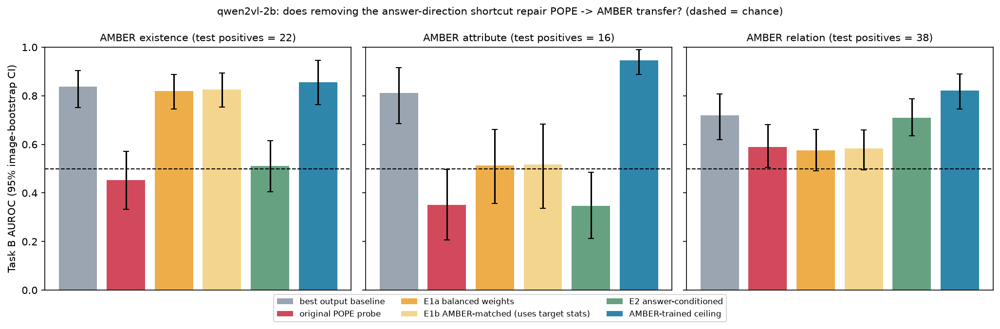
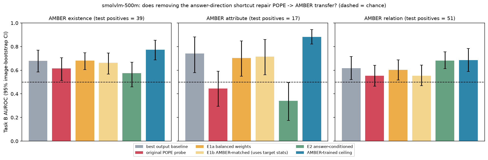

# Probe vs output-level baselines: results summary

Generated by `src/make_summary.py` from the CSVs in this folder; every number below is read from a CSV. Protocol is frozen (prompt, forced yes/no scoring, last prompt token, image-level 70/15/15 split from the `split` column). Test data was used only for the numbers reported here; layer, regularisation, PCA size and class weighting were chosen on dev (or by image-grouped CV on train+dev).

## Runs included

Each folder holds `command.txt` (exact command), `run_config.json` and `run.log`.

| run | models | probe | class_weight | pca | selection | seeds | pope_rows | command |
|---|---|---|---|---|---|---|---|---|
| cross_model_logreg | qwen2vl-2b smolvlm-500m | logreg | True | none | dev split | [0] | 3000 | `python src/probe_transfer_eval.py --out-dir results/final/cross_model_logreg --models qwen2vl-2b smolvlm-500m --probe logreg` |
| cross_model_mlp | qwen2vl-2b smolvlm-500m | mlp | True | none | dev split | [0, 1, 2] | 3000 | `python src/probe_transfer_eval.py --out-dir results/final/cross_model_mlp --models qwen2vl-2b smolvlm-500m --probe mlp --seeds 0 1 2` |
| qwen_logreg | qwen2vl-2b | logreg | True | none | dev split | [0] | 9000 | `python src/probe_transfer_eval.py --out-dir results/final/qwen_logreg --models qwen2vl-2b --probe logreg --recalibrate` |
| qwen_logreg_cv5 | qwen2vl-2b | logreg | True | none | 5-fold image-grouped CV | [0] | 9000 | `python src/probe_transfer_eval.py --out-dir results/final/qwen_logreg_cv5 --models qwen2vl-2b --probe logreg --layer-cv 5 --recalibrate` |
| qwen_logreg_noclassweight | qwen2vl-2b | logreg | False | none | dev split | [0] | 9000 | `python src/probe_transfer_eval.py --out-dir results/final/qwen_logreg_noclassweight --models qwen2vl-2b --probe logreg --no-class-weight` |
| qwen_logreg_pca | qwen2vl-2b | logreg | True | [64, 128, 256] | dev split | [0] | 9000 | `python src/probe_transfer_eval.py --out-dir results/final/qwen_logreg_pca --models qwen2vl-2b --probe logreg --pca 64 128 256` |
| qwen_mlp | qwen2vl-2b | mlp | True | none | dev split | [0, 1, 2] | 9000 | `python src/probe_transfer_eval.py --out-dir results/final/qwen_mlp --models qwen2vl-2b --probe mlp --seeds 0 1 2` |
## Not run (blocked by missing cache files)

All caches with committed metadata have their feature files.

## Key results and caveats (all numbers read from the CSVs below)

* **Task B** (163 positives in the test split): hidden-state probe (layer 28) AUROC 0.892 [0.851, 0.925] vs best output-level baseline (token prob (raw)) 0.801 [0.736, 0.858]. Paired difference +0.090 [+0.046, +0.146], p = 0.002. Versus a probe trained on the four output signals only: +0.087 [+0.045, +0.140], p = 0.002.
  * Descriptive only (per-layer test AUROC, not used for selection): entry 0 (token embedding, identical for every prompt) gives 0.500; the per-layer probe first exceeds the best baseline at entry 13 and the best layer by the selection metric is 28 (entries run 0 to 28).
* **Task A** (28 positives in the test split): hidden-state probe (layer 28) AUROC 0.906 [0.842, 0.950] vs best output-level baseline (token prob (raw)) 0.832 [0.754, 0.895]. Paired difference +0.073 [+0.026, +0.128], p = 0.006. Versus a probe trained on the four output signals only: +0.082 [+0.031, +0.130], p = 0.002.
* **Task B is the primary result.** Task A has few positives, so its CIs are wide and its per-setting rows (e.g. the `random` setting) rest on a handful of positives; do not draw conclusions from them.
* Layer selection: dev-split picked layer 28 (B) / 28 (A) with test AUROC 0.892 [0.851, 0.925] / 0.906 [0.842, 0.950]; image-grouped 5-fold CV picked layer 28 (B) / 16 (A) with test AUROC 0.894 [0.855, 0.927] / 0.898 [0.842, 0.947]. Compare the intervals before reading anything into a layer difference.
* The last hidden-state entry is what the output layer reads, so a probe there can partly decode the answer distribution. The logit-only probe (four output signals) is therefore the fairest 'does the hidden state add information' control; the paired row 'probe vs logit-only' above is that test.
* The balanced-class-weight probe outputs are not calibrated probabilities (see Calibration; Platt scaling fitted on dev repairs this). AUROC is unaffected by calibration.
* The p-values are not corrected for the many comparisons in the paired tables.
* **Transfer (Task B, AMBER test split, n_pos in the subset tables below):** existence: transferred 0.453 [0.333, 0.571], best baseline 0.837, AMBER-trained ceiling 0.856 [0.764, 0.946]; attribute: transferred 0.352 [0.206, 0.497], best baseline 0.812, AMBER-trained ceiling 0.945 [0.887, 0.991]; relation: transferred 0.590 [0.505, 0.681], best baseline 0.719, AMBER-trained ceiling 0.821 [0.745, 0.889]. Values below 0.5 mean the POPE-trained probe ranks AMBER errors the wrong way round. The AMBER-trained ceiling shows the signal is present in-domain, so the failure is the transfer of the probe direction, not the absence of signal.
* **Plausible (not proven) reason for the failed transfer:** error composition differs. POPE errors are 0.853 missed-yes and the rest hallucinated-yes, whereas for AMBER attribute is 0.705 hallucinated-yes, existence is 0.578 hallucinated-yes, relation is 0.176 hallucinated-yes. A probe trained on POPE errors can therefore partly learn 'answered no although the object is present', which is the wrong signal for AMBER-attribute. Task A (answered-yes questions only, so the answer direction is fixed) is the cleaner transfer test, but it has very few positives per AMBER subset.
* Scope: Qwen2-VL-2B (main) and SmolVLM-500M (cross-model run, shared 3,000 questions) on POPE, and AMBER with 1,000 queries per subset (existence / attribute / relation), one image-level split and one extraction run per cache. Qwen2.5-VL-3B was not run.

## Main result: Qwen2-VL-2B, logistic-regression probe, POPE test

POPE test split; AUROC with 95% image-bootstrap CI. Layer, regularisation and (if used) PCA size were chosen on dev only.

**Task B (primary): wrong vs right answer, all questions** (test n = 1314, positives = 163)

| method | layer | AUROC_CI |
|---|---|---|
| baseline: token prob (raw) |  | 0.801 [0.736, 0.858] |
| baseline: margin (|log-odds|) |  | 0.800 [0.734, 0.857] |
| baseline: binary entropy |  | 0.800 [0.734, 0.857] |
| baseline: vocab entropy |  | 0.798 [0.744, 0.844] |
| probe (logreg) | 28 | 0.892 [0.851, 0.925] |
| probe (logit-only logreg) |  | 0.805 [0.740, 0.857] |
| probe (hidden+logits, logreg) | 28 | 0.892 [0.852, 0.926] |

**Task A (secondary): hallucinated-yes vs correct-yes, answered-yes only** (test n = 550, positives = 28)

| method | layer | AUROC_CI |
|---|---|---|
| baseline: token prob (raw) |  | 0.832 [0.754, 0.895] |
| baseline: margin (|log-odds|) |  | 0.832 [0.754, 0.895] |
| baseline: binary entropy |  | 0.832 [0.754, 0.895] |
| baseline: vocab entropy |  | 0.803 [0.735, 0.874] |
| probe (logreg) | 28 | 0.906 [0.842, 0.950] |
| probe (logit-only logreg) |  | 0.824 [0.757, 0.889] |
| probe (hidden+logits, logreg) | 28 | 0.906 [0.843, 0.950] |

## Paired comparison (probe minus reference AUROC, same rows, paired image bootstrap)

`diff` > 0 means the first method is better. CI = 95% percentile; p = two-sided bootstrap p-value (smallest possible value is about 2/(B+1)). **No multiple-comparison correction** was applied across the rows of this table.

**Task B, POPE test**

| probe | reference | auc_probe | auc_baseline | diff_CI | p | n_pos |
|---|---|---|---|---|---|---|
| probe (logreg) | baseline: token prob (raw) | 0.892 | 0.801 | +0.090 [+0.046, +0.146] | 0.002 | 163 |
| probe (logreg) | baseline: margin (|log-odds|) | 0.892 | 0.8 | +0.092 [+0.047, +0.148] | 0.002 | 163 |
| probe (logreg) | baseline: binary entropy | 0.892 | 0.8 | +0.092 [+0.047, +0.148] | 0.002 | 163 |
| probe (logreg) | baseline: vocab entropy | 0.892 | 0.798 | +0.094 [+0.052, +0.143] | 0.002 | 163 |
| probe (logit-only logreg) | baseline: token prob (raw) | 0.805 | 0.801 | +0.003 [-0.011, +0.018] | 0.611 | 163 |
| probe (logit-only logreg) | baseline: margin (|log-odds|) | 0.805 | 0.8 | +0.005 [-0.010, +0.020] | 0.511 | 163 |
| probe (logit-only logreg) | baseline: binary entropy | 0.805 | 0.8 | +0.005 [-0.010, +0.020] | 0.511 | 163 |
| probe (logit-only logreg) | baseline: vocab entropy | 0.805 | 0.798 | +0.007 [-0.025, +0.034] | 0.689 | 163 |
| probe (hidden+logits, logreg) | baseline: token prob (raw) | 0.892 | 0.801 | +0.091 [+0.048, +0.146] | 0.002 | 163 |
| probe (hidden+logits, logreg) | baseline: margin (|log-odds|) | 0.892 | 0.8 | +0.092 [+0.048, +0.149] | 0.002 | 163 |
| probe (hidden+logits, logreg) | baseline: binary entropy | 0.892 | 0.8 | +0.092 [+0.048, +0.149] | 0.002 | 163 |
| probe (hidden+logits, logreg) | baseline: vocab entropy | 0.892 | 0.798 | +0.094 [+0.053, +0.143] | 0.002 | 163 |
| probe (logreg) | probe (logit-only logreg) | 0.892 | 0.805 | +0.087 [+0.045, +0.140] | 0.002 | 163 |
| probe (hidden+logits, logreg) | probe (logit-only logreg) | 0.892 | 0.805 | +0.087 [+0.046, +0.138] | 0.002 | 163 |
| probe (hidden+logits, logreg) | probe (logreg) | 0.892 | 0.892 | +0.000 [-0.002, +0.002] | 0.795 | 163 |

**Task B, AMBER attribute test**

| probe | reference | auc_probe | auc_baseline | diff_CI | p | n_pos |
|---|---|---|---|---|---|---|
| probe POPE->AMBER | baseline: token prob (raw) | 0.352 | 0.811 | -0.460 [-0.583, -0.335] | 0.002 | 16 |
| probe POPE->AMBER | baseline: margin (|log-odds|) | 0.352 | 0.812 | -0.460 [-0.586, -0.335] | 0.002 | 16 |
| probe POPE->AMBER | baseline: binary entropy | 0.352 | 0.812 | -0.460 [-0.586, -0.335] | 0.002 | 16 |
| probe POPE->AMBER | baseline: vocab entropy | 0.352 | 0.798 | -0.447 [-0.598, -0.299] | 0.002 | 16 |
| probe (logit-only logreg) POPE->AMBER | baseline: token prob (raw) | 0.814 | 0.811 | +0.003 [-0.019, +0.026] | 0.869 | 16 |
| probe (logit-only logreg) POPE->AMBER | baseline: margin (|log-odds|) | 0.814 | 0.812 | +0.002 [-0.019, +0.025] | 0.919 | 16 |
| probe (logit-only logreg) POPE->AMBER | baseline: binary entropy | 0.814 | 0.812 | +0.002 [-0.019, +0.025] | 0.919 | 16 |
| probe (logit-only logreg) POPE->AMBER | baseline: vocab entropy | 0.814 | 0.798 | +0.016 [-0.036, +0.063] | 0.529 | 16 |
| probe (hidden+logits, logreg) POPE->AMBER | baseline: token prob (raw) | 0.358 | 0.811 | -0.453 [-0.579, -0.330] | 0.002 | 16 |
| probe (hidden+logits, logreg) POPE->AMBER | baseline: margin (|log-odds|) | 0.358 | 0.812 | -0.454 [-0.580, -0.333] | 0.002 | 16 |
| probe (hidden+logits, logreg) POPE->AMBER | baseline: binary entropy | 0.358 | 0.812 | -0.454 [-0.580, -0.333] | 0.002 | 16 |
| probe (hidden+logits, logreg) POPE->AMBER | baseline: vocab entropy | 0.358 | 0.798 | -0.440 [-0.586, -0.300] | 0.002 | 16 |
| probe POPE->AMBER | probe (logit-only logreg) POPE->AMBER | 0.352 | 0.814 | -0.462 [-0.596, -0.334] | 0.002 | 16 |
| probe (hidden+logits, logreg) POPE->AMBER | probe (logit-only logreg) POPE->AMBER | 0.358 | 0.814 | -0.456 [-0.587, -0.332] | 0.002 | 16 |
| probe (hidden+logits, logreg) POPE->AMBER | probe POPE->AMBER | 0.358 | 0.352 | +0.006 [-0.011, +0.022] | 0.476 | 16 |

**Task B, AMBER existence test**

| probe | reference | auc_probe | auc_baseline | diff_CI | p | n_pos |
|---|---|---|---|---|---|---|
| probe POPE->AMBER | baseline: token prob (raw) | 0.453 | 0.808 | -0.355 [-0.495, -0.213] | 0.002 | 22 |
| probe POPE->AMBER | baseline: margin (|log-odds|) | 0.453 | 0.808 | -0.355 [-0.495, -0.211] | 0.002 | 22 |
| probe POPE->AMBER | baseline: binary entropy | 0.453 | 0.808 | -0.355 [-0.495, -0.211] | 0.002 | 22 |
| probe POPE->AMBER | baseline: vocab entropy | 0.453 | 0.837 | -0.384 [-0.524, -0.240] | 0.002 | 22 |
| probe (logit-only logreg) POPE->AMBER | baseline: token prob (raw) | 0.825 | 0.808 | +0.016 [-0.005, +0.040] | 0.136 | 22 |
| probe (logit-only logreg) POPE->AMBER | baseline: margin (|log-odds|) | 0.825 | 0.808 | +0.016 [-0.005, +0.040] | 0.140 | 22 |
| probe (logit-only logreg) POPE->AMBER | baseline: binary entropy | 0.825 | 0.808 | +0.016 [-0.005, +0.040] | 0.140 | 22 |
| probe (logit-only logreg) POPE->AMBER | baseline: vocab entropy | 0.825 | 0.837 | -0.013 [-0.044, +0.025] | 0.428 | 22 |
| probe (hidden+logits, logreg) POPE->AMBER | baseline: token prob (raw) | 0.454 | 0.808 | -0.355 [-0.494, -0.214] | 0.002 | 22 |
| probe (hidden+logits, logreg) POPE->AMBER | baseline: margin (|log-odds|) | 0.454 | 0.808 | -0.355 [-0.494, -0.213] | 0.002 | 22 |
| probe (hidden+logits, logreg) POPE->AMBER | baseline: binary entropy | 0.454 | 0.808 | -0.355 [-0.494, -0.213] | 0.002 | 22 |
| probe (hidden+logits, logreg) POPE->AMBER | baseline: vocab entropy | 0.454 | 0.837 | -0.384 [-0.525, -0.240] | 0.002 | 22 |
| probe POPE->AMBER | probe (logit-only logreg) POPE->AMBER | 0.453 | 0.825 | -0.372 [-0.509, -0.233] | 0.002 | 22 |
| probe (hidden+logits, logreg) POPE->AMBER | probe (logit-only logreg) POPE->AMBER | 0.454 | 0.825 | -0.371 [-0.508, -0.233] | 0.002 | 22 |
| probe (hidden+logits, logreg) POPE->AMBER | probe POPE->AMBER | 0.454 | 0.453 | +0.000 [-0.010, +0.012] | 0.977 | 22 |

**Task B, AMBER relation test**

| probe | reference | auc_probe | auc_baseline | diff_CI | p | n_pos |
|---|---|---|---|---|---|---|
| probe POPE->AMBER | baseline: token prob (raw) | 0.59 | 0.719 | -0.129 [-0.259, +0.007] | 0.062 | 38 |
| probe POPE->AMBER | baseline: margin (|log-odds|) | 0.59 | 0.718 | -0.128 [-0.261, +0.009] | 0.066 | 38 |
| probe POPE->AMBER | baseline: binary entropy | 0.59 | 0.718 | -0.128 [-0.261, +0.009] | 0.066 | 38 |
| probe POPE->AMBER | baseline: vocab entropy | 0.59 | 0.68 | -0.090 [-0.218, +0.058] | 0.230 | 38 |
| probe (logit-only logreg) POPE->AMBER | baseline: token prob (raw) | 0.739 | 0.719 | +0.020 [-0.034, +0.068] | 0.454 | 38 |
| probe (logit-only logreg) POPE->AMBER | baseline: margin (|log-odds|) | 0.739 | 0.718 | +0.021 [-0.033, +0.068] | 0.426 | 38 |
| probe (logit-only logreg) POPE->AMBER | baseline: binary entropy | 0.739 | 0.718 | +0.021 [-0.033, +0.068] | 0.426 | 38 |
| probe (logit-only logreg) POPE->AMBER | baseline: vocab entropy | 0.739 | 0.68 | +0.058 [-0.018, +0.143] | 0.160 | 38 |
| probe (hidden+logits, logreg) POPE->AMBER | baseline: token prob (raw) | 0.592 | 0.719 | -0.127 [-0.253, +0.000] | 0.054 | 38 |
| probe (hidden+logits, logreg) POPE->AMBER | baseline: margin (|log-odds|) | 0.592 | 0.718 | -0.126 [-0.253, +0.002] | 0.062 | 38 |
| probe (hidden+logits, logreg) POPE->AMBER | baseline: binary entropy | 0.592 | 0.718 | -0.126 [-0.253, +0.002] | 0.062 | 38 |
| probe (hidden+logits, logreg) POPE->AMBER | baseline: vocab entropy | 0.592 | 0.68 | -0.088 [-0.219, +0.060] | 0.236 | 38 |
| probe POPE->AMBER | probe (logit-only logreg) POPE->AMBER | 0.59 | 0.739 | -0.148 [-0.274, -0.014] | 0.036 | 38 |
| probe (hidden+logits, logreg) POPE->AMBER | probe (logit-only logreg) POPE->AMBER | 0.592 | 0.739 | -0.147 [-0.271, -0.016] | 0.030 | 38 |
| probe (hidden+logits, logreg) POPE->AMBER | probe POPE->AMBER | 0.592 | 0.59 | +0.002 [-0.011, +0.013] | 0.869 | 38 |

**Task A, POPE test**

| probe | reference | auc_probe | auc_baseline | diff_CI | p | n_pos |
|---|---|---|---|---|---|---|
| probe (logreg) | baseline: token prob (raw) | 0.906 | 0.832 | +0.073 [+0.026, +0.128] | 0.006 | 28 |
| probe (logreg) | baseline: margin (|log-odds|) | 0.906 | 0.832 | +0.073 [+0.026, +0.128] | 0.006 | 28 |
| probe (logreg) | baseline: binary entropy | 0.906 | 0.832 | +0.073 [+0.026, +0.128] | 0.006 | 28 |
| probe (logreg) | baseline: vocab entropy | 0.906 | 0.803 | +0.102 [+0.040, +0.157] | 0.002 | 28 |
| probe (logit-only logreg) | baseline: token prob (raw) | 0.824 | 0.832 | -0.009 [-0.036, +0.021] | 0.643 | 28 |
| probe (logit-only logreg) | baseline: margin (|log-odds|) | 0.824 | 0.832 | -0.009 [-0.036, +0.022] | 0.653 | 28 |
| probe (logit-only logreg) | baseline: binary entropy | 0.824 | 0.832 | -0.009 [-0.036, +0.022] | 0.653 | 28 |
| probe (logit-only logreg) | baseline: vocab entropy | 0.824 | 0.803 | +0.020 [-0.007, +0.046] | 0.130 | 28 |
| probe (hidden+logits, logreg) | baseline: token prob (raw) | 0.906 | 0.832 | +0.074 [+0.026, +0.128] | 0.006 | 28 |
| probe (hidden+logits, logreg) | baseline: margin (|log-odds|) | 0.906 | 0.832 | +0.074 [+0.026, +0.128] | 0.006 | 28 |
| probe (hidden+logits, logreg) | baseline: binary entropy | 0.906 | 0.832 | +0.074 [+0.026, +0.128] | 0.006 | 28 |
| probe (hidden+logits, logreg) | baseline: vocab entropy | 0.906 | 0.803 | +0.103 [+0.041, +0.157] | 0.002 | 28 |
| probe (logreg) | probe (logit-only logreg) | 0.906 | 0.824 | +0.082 [+0.031, +0.130] | 0.002 | 28 |
| probe (hidden+logits, logreg) | probe (logit-only logreg) | 0.906 | 0.824 | +0.083 [+0.032, +0.131] | 0.002 | 28 |
| probe (hidden+logits, logreg) | probe (logreg) | 0.906 | 0.906 | +0.001 [-0.000, +0.003] | 0.575 | 28 |

**Task A, AMBER attribute test**

| probe | reference | auc_probe | auc_baseline | diff_CI | p | n_pos |
|---|---|---|---|---|---|---|
| probe POPE->AMBER | baseline: token prob (raw) | 0.542 | 0.638 | -0.096 [-0.295, +0.084] | 0.324 | 13 |
| probe POPE->AMBER | baseline: margin (|log-odds|) | 0.542 | 0.642 | -0.100 [-0.297, +0.084] | 0.318 | 13 |
| probe POPE->AMBER | baseline: binary entropy | 0.542 | 0.642 | -0.100 [-0.297, +0.084] | 0.318 | 13 |
| probe POPE->AMBER | baseline: vocab entropy | 0.542 | 0.677 | -0.135 [-0.308, +0.042] | 0.132 | 13 |
| probe (logit-only logreg) POPE->AMBER | baseline: token prob (raw) | 0.673 | 0.638 | +0.035 [-0.033, +0.101] | 0.348 | 13 |
| probe (logit-only logreg) POPE->AMBER | baseline: margin (|log-odds|) | 0.673 | 0.642 | +0.031 [-0.038, +0.100] | 0.426 | 13 |
| probe (logit-only logreg) POPE->AMBER | baseline: binary entropy | 0.673 | 0.642 | +0.031 [-0.038, +0.100] | 0.426 | 13 |
| probe (logit-only logreg) POPE->AMBER | baseline: vocab entropy | 0.673 | 0.677 | -0.004 [-0.089, +0.087] | 0.997 | 13 |
| probe (hidden+logits, logreg) POPE->AMBER | baseline: token prob (raw) | 0.546 | 0.638 | -0.092 [-0.290, +0.091] | 0.340 | 13 |
| probe (hidden+logits, logreg) POPE->AMBER | baseline: margin (|log-odds|) | 0.546 | 0.642 | -0.096 [-0.295, +0.088] | 0.322 | 13 |
| probe (hidden+logits, logreg) POPE->AMBER | baseline: binary entropy | 0.546 | 0.642 | -0.096 [-0.295, +0.088] | 0.322 | 13 |
| probe (hidden+logits, logreg) POPE->AMBER | baseline: vocab entropy | 0.546 | 0.677 | -0.131 [-0.292, +0.043] | 0.144 | 13 |
| probe POPE->AMBER | probe (logit-only logreg) POPE->AMBER | 0.542 | 0.673 | -0.131 [-0.316, +0.042] | 0.154 | 13 |
| probe (hidden+logits, logreg) POPE->AMBER | probe (logit-only logreg) POPE->AMBER | 0.546 | 0.673 | -0.127 [-0.310, +0.042] | 0.166 | 13 |
| probe (hidden+logits, logreg) POPE->AMBER | probe POPE->AMBER | 0.546 | 0.542 | +0.004 [-0.014, +0.032] | 0.903 | 13 |

**Task A, AMBER existence test**

| probe | reference | auc_probe | auc_baseline | diff_CI | p | n_pos |
|---|---|---|---|---|---|---|
| probe POPE->AMBER | baseline: token prob (raw) | 0.674 | 0.747 | -0.073 [-0.231, +0.055] | 0.302 | 16 |
| probe POPE->AMBER | baseline: margin (|log-odds|) | 0.674 | 0.746 | -0.072 [-0.230, +0.061] | 0.314 | 16 |
| probe POPE->AMBER | baseline: binary entropy | 0.674 | 0.746 | -0.072 [-0.230, +0.061] | 0.314 | 16 |
| probe POPE->AMBER | baseline: vocab entropy | 0.674 | 0.819 | -0.145 [-0.302, -0.013] | 0.034 | 16 |
| probe (logit-only logreg) POPE->AMBER | baseline: token prob (raw) | 0.786 | 0.747 | +0.039 [+0.002, +0.081] | 0.038 | 16 |
| probe (logit-only logreg) POPE->AMBER | baseline: margin (|log-odds|) | 0.786 | 0.746 | +0.040 [+0.004, +0.083] | 0.034 | 16 |
| probe (logit-only logreg) POPE->AMBER | baseline: binary entropy | 0.786 | 0.746 | +0.040 [+0.004, +0.083] | 0.034 | 16 |
| probe (logit-only logreg) POPE->AMBER | baseline: vocab entropy | 0.786 | 0.819 | -0.033 [-0.083, +0.004] | 0.072 | 16 |
| probe (hidden+logits, logreg) POPE->AMBER | baseline: token prob (raw) | 0.672 | 0.747 | -0.075 [-0.236, +0.054] | 0.290 | 16 |
| probe (hidden+logits, logreg) POPE->AMBER | baseline: margin (|log-odds|) | 0.672 | 0.746 | -0.074 [-0.232, +0.060] | 0.302 | 16 |
| probe (hidden+logits, logreg) POPE->AMBER | baseline: binary entropy | 0.672 | 0.746 | -0.074 [-0.232, +0.060] | 0.302 | 16 |
| probe (hidden+logits, logreg) POPE->AMBER | baseline: vocab entropy | 0.672 | 0.819 | -0.147 [-0.306, -0.015] | 0.032 | 16 |
| probe POPE->AMBER | probe (logit-only logreg) POPE->AMBER | 0.674 | 0.786 | -0.112 [-0.267, +0.021] | 0.118 | 16 |
| probe (hidden+logits, logreg) POPE->AMBER | probe (logit-only logreg) POPE->AMBER | 0.672 | 0.786 | -0.114 [-0.269, +0.019] | 0.116 | 16 |
| probe (hidden+logits, logreg) POPE->AMBER | probe POPE->AMBER | 0.672 | 0.674 | -0.002 [-0.009, +0.000] | 0.677 | 16 |

**Task A, AMBER relation test**

| probe | reference | auc_probe | auc_baseline | diff_CI | p | n_pos |
|---|---|---|---|---|---|---|
| probe POPE->AMBER | baseline: token prob (raw) | 0.585 | 0.637 | -0.052 [-0.208, +0.096] | 0.518 | 7 |
| probe POPE->AMBER | baseline: margin (|log-odds|) | 0.585 | 0.632 | -0.047 [-0.198, +0.099] | 0.552 | 7 |
| probe POPE->AMBER | baseline: binary entropy | 0.585 | 0.632 | -0.047 [-0.198, +0.099] | 0.552 | 7 |
| probe POPE->AMBER | baseline: vocab entropy | 0.585 | 0.728 | -0.143 [-0.423, +0.220] | 0.402 | 7 |
| probe (logit-only logreg) POPE->AMBER | baseline: token prob (raw) | 0.75 | 0.637 | +0.113 [-0.057, +0.275] | 0.164 | 7 |
| probe (logit-only logreg) POPE->AMBER | baseline: margin (|log-odds|) | 0.75 | 0.632 | +0.118 [-0.050, +0.279] | 0.158 | 7 |
| probe (logit-only logreg) POPE->AMBER | baseline: binary entropy | 0.75 | 0.632 | +0.118 [-0.050, +0.279] | 0.158 | 7 |
| probe (logit-only logreg) POPE->AMBER | baseline: vocab entropy | 0.75 | 0.728 | +0.022 [-0.109, +0.179] | 0.730 | 7 |
| probe (hidden+logits, logreg) POPE->AMBER | baseline: token prob (raw) | 0.585 | 0.637 | -0.052 [-0.208, +0.096] | 0.518 | 7 |
| probe (hidden+logits, logreg) POPE->AMBER | baseline: margin (|log-odds|) | 0.585 | 0.632 | -0.047 [-0.198, +0.099] | 0.552 | 7 |
| probe (hidden+logits, logreg) POPE->AMBER | baseline: binary entropy | 0.585 | 0.632 | -0.047 [-0.198, +0.099] | 0.552 | 7 |
| probe (hidden+logits, logreg) POPE->AMBER | baseline: vocab entropy | 0.585 | 0.728 | -0.143 [-0.423, +0.220] | 0.402 | 7 |
| probe POPE->AMBER | probe (logit-only logreg) POPE->AMBER | 0.585 | 0.75 | -0.165 [-0.378, +0.062] | 0.158 | 7 |
| probe (hidden+logits, logreg) POPE->AMBER | probe (logit-only logreg) POPE->AMBER | 0.585 | 0.75 | -0.165 [-0.378, +0.062] | 0.160 | 7 |
| probe (hidden+logits, logreg) POPE->AMBER | probe POPE->AMBER | 0.585 | 0.585 | +0.000 [-0.000, +0.000] | 1.000 | 7 |

## By POPE setting (test split; AUROC [95% CI])

Per-setting positives are few for Task A (see n_pos); read those rows as indicative only.

**Task B** (n_pos: overall=163, random=49, popular=53, adversarial=61)

| method | overall | random | popular | adversarial |
|---|---|---|---|---|
| baseline: binary entropy | 0.800 [0.734, 0.857] | 0.823 [0.752, 0.880] | 0.793 [0.719, 0.855] | 0.782 [0.716, 0.841] |
| baseline: margin (|log-odds|) | 0.800 [0.734, 0.857] | 0.823 [0.752, 0.880] | 0.793 [0.719, 0.855] | 0.782 [0.716, 0.841] |
| baseline: token prob (raw) | 0.801 [0.736, 0.858] | 0.824 [0.753, 0.880] | 0.796 [0.723, 0.857] | 0.784 [0.717, 0.843] |
| baseline: vocab entropy | 0.798 [0.744, 0.844] | 0.807 [0.749, 0.855] | 0.801 [0.740, 0.847] | 0.784 [0.730, 0.832] |
| probe (hidden+logits, logreg) | 0.892 [0.852, 0.926] | 0.929 [0.894, 0.962] | 0.904 [0.860, 0.940] | 0.841 [0.791, 0.883] |
| probe (logit-only logreg) | 0.805 [0.740, 0.857] | 0.825 [0.756, 0.880] | 0.800 [0.727, 0.853] | 0.788 [0.726, 0.843] |
| probe (logreg) | 0.892 [0.851, 0.925] | 0.930 [0.894, 0.962] | 0.904 [0.861, 0.940] | 0.839 [0.789, 0.881] |

**Task A** (n_pos: overall=28, random=4, popular=8, adversarial=16)

| method | overall | random | popular | adversarial |
|---|---|---|---|---|
| baseline: binary entropy | 0.832 [0.754, 0.895] | 0.787 [0.561, 0.937] | 0.834 [0.702, 0.925] | 0.843 [0.755, 0.906] |
| baseline: margin (|log-odds|) | 0.832 [0.754, 0.895] | 0.787 [0.561, 0.937] | 0.834 [0.702, 0.925] | 0.843 [0.755, 0.906] |
| baseline: token prob (raw) | 0.832 [0.754, 0.895] | 0.789 [0.561, 0.938] | 0.834 [0.702, 0.925] | 0.843 [0.755, 0.906] |
| baseline: vocab entropy | 0.803 [0.735, 0.874] | 0.806 [0.597, 0.945] | 0.779 [0.677, 0.874] | 0.817 [0.740, 0.888] |
| probe (hidden+logits, logreg) | 0.906 [0.843, 0.950] | 0.928 [0.850, 0.988] | 0.938 [0.874, 0.979] | 0.885 [0.798, 0.944] |
| probe (logit-only logreg) | 0.824 [0.757, 0.889] | 0.803 [0.577, 0.955] | 0.807 [0.707, 0.886] | 0.838 [0.763, 0.903] |
| probe (logreg) | 0.906 [0.842, 0.950] | 0.925 [0.848, 0.984] | 0.937 [0.874, 0.978] | 0.885 [0.798, 0.944] |

## Calibration of the probability of the bad outcome (POPE test; 15 equal-width bins)

The probe uses balanced class weights, which shifts its raw probabilities upwards, so the raw probe is compared with the model's own confidence and with a Platt-scaled probe (Platt fitted on dev only, or out-of-fold when CV is used). `brier_constant_base_rate` is the Brier score of always predicting the test base rate.

**Task B** (n = 1314, positives = 163)

| method | ece | brier | brier_constant_base_rate |
|---|---|---|---|
| probe (logreg) | 0.117 | 0.108 | 0.109 |
| probe (logit-only logreg) | 0.271 | 0.195 | 0.109 |
| probe (hidden+logits, logreg) | 0.116 | 0.107 | 0.109 |
| model confidence (P(wrong) = 1 - conf) | 0.045 | 0.095 | 0.109 |
| probe (hidden) + Platt | 0.028 | 0.076 | 0.109 |

**Task A** (n = 550, positives = 28)

| method | ece | brier | brier_constant_base_rate |
|---|---|---|---|
| probe (logreg) | 0.094 | 0.077 | 0.048 |
| probe (logit-only logreg) | 0.259 | 0.182 | 0.048 |
| probe (hidden+logits, logreg) | 0.094 | 0.077 | 0.048 |
| model confidence (P(wrong) = 1 - conf) | 0.07 | 0.055 | 0.048 |
| probe (hidden) + Platt | 0.034 | 0.04 | 0.048 |

## Selective prediction (Task B scores; abstain on the answers judged most likely wrong)

AURC = mean risk over coverage (lower is better); AUACC = 1 - AURC. `random_aurc` is the error rate, `oracle_aurc` abstains on all errors first.

| eval_set | method | aurc | auacc | oracle_aurc | random_aurc | n |
|---|---|---|---|---|---|---|
| AMBER attribute test | baseline: token prob (raw) | 0.038 | 0.962 | 0.0079 | 0.1194 | 134 |
| AMBER attribute test | baseline: margin (|log-odds|) | 0.0377 | 0.9623 | 0.0079 | 0.1194 | 134 |
| AMBER attribute test | baseline: binary entropy | 0.0377 | 0.9623 | 0.0079 | 0.1194 | 134 |
| AMBER attribute test | baseline: vocab entropy | 0.0403 | 0.9597 | 0.0079 | 0.1194 | 134 |
| AMBER attribute test | probe POPE->AMBER | 0.1694 | 0.8306 | 0.0079 | 0.1194 | 134 |
| AMBER attribute test | probe (logit-only logreg) POPE->AMBER | 0.037 | 0.963 | 0.0079 | 0.1194 | 134 |
| AMBER attribute test | probe (hidden+logits, logreg) POPE->AMBER | 0.1684 | 0.8316 | 0.0079 | 0.1194 | 134 |
| AMBER existence test | baseline: token prob (raw) | 0.0389 | 0.9611 | 0.0103 | 0.1375 | 160 |
| AMBER existence test | baseline: margin (|log-odds|) | 0.0389 | 0.9611 | 0.0103 | 0.1375 | 160 |
| AMBER existence test | baseline: binary entropy | 0.0389 | 0.9611 | 0.0103 | 0.1375 | 160 |
| AMBER existence test | baseline: vocab entropy | 0.0341 | 0.9659 | 0.0103 | 0.1375 | 160 |
| AMBER existence test | probe POPE->AMBER | 0.1313 | 0.8687 | 0.0103 | 0.1375 | 160 |
| AMBER existence test | probe (logit-only logreg) POPE->AMBER | 0.0361 | 0.9639 | 0.0103 | 0.1375 | 160 |
| AMBER existence test | probe (hidden+logits, logreg) POPE->AMBER | 0.1331 | 0.8669 | 0.0103 | 0.1375 | 160 |
| AMBER relation test | baseline: token prob (raw) | 0.1503 | 0.8497 | 0.0464 | 0.2857 | 133 |
| AMBER relation test | baseline: margin (|log-odds|) | 0.1511 | 0.8489 | 0.0464 | 0.2857 | 133 |
| AMBER relation test | baseline: binary entropy | 0.1511 | 0.8489 | 0.0464 | 0.2857 | 133 |
| AMBER relation test | baseline: vocab entropy | 0.1757 | 0.8243 | 0.0464 | 0.2857 | 133 |
| AMBER relation test | probe POPE->AMBER | 0.2076 | 0.7924 | 0.0464 | 0.2857 | 133 |
| AMBER relation test | probe (logit-only logreg) POPE->AMBER | 0.1449 | 0.8551 | 0.0464 | 0.2857 | 133 |
| AMBER relation test | probe (hidden+logits, logreg) POPE->AMBER | 0.208 | 0.792 | 0.0464 | 0.2857 | 133 |
| POPE test | baseline: token prob (raw) | 0.045 | 0.955 | 0.0081 | 0.124 | 1314 |
| POPE test | baseline: margin (|log-odds|) | 0.0453 | 0.9547 | 0.0081 | 0.124 | 1314 |
| POPE test | baseline: binary entropy | 0.0453 | 0.9547 | 0.0081 | 0.124 | 1314 |
| POPE test | baseline: vocab entropy | 0.0394 | 0.9606 | 0.0081 | 0.124 | 1314 |
| POPE test | probe (logreg) | 0.0245 | 0.9755 | 0.0081 | 0.124 | 1314 |
| POPE test | probe (logit-only logreg) | 0.0427 | 0.9573 | 0.0081 | 0.124 | 1314 |
| POPE test | probe (hidden+logits, logreg) | 0.0244 | 0.9756 | 0.0081 | 0.124 | 1314 |

## Qwen2-VL-2B, MLP probe (seed 0 rows), POPE test

POPE test split; AUROC with 95% image-bootstrap CI. Layer, regularisation and (if used) PCA size were chosen on dev only.

**Task B (primary): wrong vs right answer, all questions** (test n = 1314, positives = 163)

| method | layer | AUROC_CI |
|---|---|---|
| baseline: token prob (raw) |  | 0.801 [0.736, 0.858] |
| baseline: margin (|log-odds|) |  | 0.800 [0.734, 0.857] |
| baseline: binary entropy |  | 0.800 [0.734, 0.857] |
| baseline: vocab entropy |  | 0.798 [0.744, 0.844] |
| probe (mlp) | 26 | 0.888 [0.844, 0.927] |
| probe (logit-only logreg) |  | 0.805 [0.740, 0.857] |
| probe (hidden+logits, mlp) | 26 | 0.889 [0.849, 0.923] |

**Task A (secondary): hallucinated-yes vs correct-yes, answered-yes only** (test n = 550, positives = 28)

| method | layer | AUROC_CI |
|---|---|---|
| baseline: token prob (raw) |  | 0.832 [0.754, 0.895] |
| baseline: margin (|log-odds|) |  | 0.832 [0.754, 0.895] |
| baseline: binary entropy |  | 0.832 [0.754, 0.895] |
| baseline: vocab entropy |  | 0.803 [0.735, 0.874] |
| probe (mlp) | 21 | 0.883 [0.815, 0.937] |
| probe (logit-only logreg) |  | 0.824 [0.757, 0.889] |
| probe (hidden+logits, mlp) | 21 | 0.871 [0.812, 0.932] |

## MLP probe across seeds (test AUROC; whole layer/regularisation selection repeated per seed)

| model | task | method | n_seeds | mean_std | per_seed_auroc | per_seed_layer |
|---|---|---|---|---|---|---|
| qwen2vl-2b | A | probe (hidden+logits, mlp) | 3 | 0.886 ± 0.015 | 0:0.8710;1:0.8855;2:0.9011 | 0:21;1:28;2:27 |
| qwen2vl-2b | A | probe (logit-only logreg) | 3 | 0.824 ± 0.000 | 0:0.8236;1:0.8236;2:0.8236 |  |
| qwen2vl-2b | A | probe (mlp) | 3 | 0.888 ± 0.006 | 0:0.8829;1:0.8950;2:0.8875 | 0:21;1:28;2:27 |
| qwen2vl-2b | B | probe (hidden+logits, mlp) | 3 | 0.883 ± 0.005 | 0:0.8891;1:0.8809;2:0.8788 | 0:26;1:28;2:21 |
| qwen2vl-2b | B | probe (logit-only logreg) | 3 | 0.805 ± 0.000 | 0:0.8047;1:0.8047;2:0.8047 |  |
| qwen2vl-2b | B | probe (mlp) | 3 | 0.884 ± 0.004 | 0:0.8882;1:0.8843;2:0.8798 | 0:26;1:28;2:21 |

## Ablations (hidden-state logreg probe, POPE test)

Same split, same test rows; only the listed option changes. Differences between these runs are mostly within the CI width, so do not over-read them.

| run | task | layer | param | pca | test_AUROC_CI | n_pos |
|---|---|---|---|---|---|---|
| qwen_logreg | B | 28 | 0.01 | none | 0.892 [0.851, 0.925] | 163 |
| qwen_logreg | A | 28 | 0.01 | none | 0.906 [0.842, 0.950] | 28 |
| qwen_logreg_cv5 | B | 28 | 0.001 | none | 0.894 [0.855, 0.927] | 163 |
| qwen_logreg_cv5 | A | 16 | 0.001 | none | 0.898 [0.842, 0.947] | 28 |
| qwen_logreg_noclassweight | B | 28 | 0.01 | none | 0.893 [0.854, 0.926] | 163 |
| qwen_logreg_noclassweight | A | 28 | 0.01 | none | 0.899 [0.831, 0.945] | 28 |
| qwen_logreg_pca | B | 21 | 0.01 | 256 | 0.887 [0.846, 0.921] | 163 |
| qwen_logreg_pca | A | 28 | 0.01 | 256 | 0.905 [0.843, 0.951] | 28 |

## Layer selection by image-grouped 5-fold CV (train+dev)

See `qwen_logreg_cv5/layerwise_auroc_task{A,B}.png` (CV AUROC ± std over folds, and test AUROC per layer).

## POPE -> AMBER transfer, Qwen2-VL-2B (logreg probe)

Hidden-state probe vs best output-level baseline, POPE test split (paired image bootstrap; probe layer chosen on POPE dev).

| model | task | test_n | n_pos | probe_layer | probe_AUROC | best_baseline | baseline_AUROC | diff_vs_baseline | diff_vs_logit_only |
|---|---|---|---|---|---|---|---|---|---|
| qwen2vl-2b | B | 1314 | 163 | 28 | 0.892 [0.851, 0.925] | token prob (raw) | 0.801 [0.736, 0.858] | +0.090 [+0.046, +0.146] p=0.002 | +0.087 [+0.045, +0.140] p=0.002 |
| qwen2vl-2b | A | 550 | 28 | 28 | 0.906 [0.842, 0.950] | token prob (raw) | 0.832 [0.754, 0.895] | +0.073 [+0.026, +0.128] p=0.006 | +0.082 [+0.031, +0.130] p=0.002 |

**POPE-trained probe applied unchanged to AMBER (test split rows) vs the best output-level baseline on the same rows**

| model | task | subset | n_pos | transferred_probe_AUROC | best_baseline | baseline_AUROC | diff |
|---|---|---|---|---|---|---|---|
| qwen2vl-2b | B | existence | 22 | 0.453 | vocab entropy | 0.837 | -0.384 [-0.524, -0.240] p=0.002 |
| qwen2vl-2b | B | attribute | 16 | 0.352 | margin (|log-odds|) | 0.812 | -0.460 [-0.586, -0.335] p=0.002 |
| qwen2vl-2b | B | relation | 38 | 0.590 | token prob (raw) | 0.719 | -0.129 [-0.259, +0.007] p=0.062 |
| qwen2vl-2b | A | existence | 16 | 0.674 | vocab entropy | 0.819 | -0.145 [-0.302, -0.013] p=0.034 |
| qwen2vl-2b | A | attribute | 13 | 0.542 | vocab entropy | 0.677 | -0.135 [-0.308, +0.042] p=0.132 |
| qwen2vl-2b | A | relation | 7 | 0.585 | vocab entropy | 0.728 | -0.143 [-0.423, +0.220] p=0.402 |

## Per-layer POPE -> AMBER transfer (descriptive)

`transfer_*` is the AUROC of the POPE-trained probe at that layer on all AMBER rows of the subset (train/dev/test rows alike, since nothing is fitted on AMBER). The reported transfer result uses the layer chosen on POPE dev only; choosing a layer by looking at this table would be selection on AMBER and is not done.

**Task B**

| layer | test_auroc | transfer_existence | transfer_attribute | transfer_relation |
|---|---|---|---|---|
| 0.0 | 0.5 | 0.5 | 0.5 | 0.5 |
| 3.0 | 0.61 | 0.533 | 0.48 | 0.446 |
| 4.0 | 0.614 | 0.507 | 0.503 | 0.488 |
| 7.0 | 0.657 | 0.497 | 0.532 | 0.549 |
| 8.0 | 0.675 | 0.52 | 0.62 | 0.556 |
| 11.0 | 0.778 | 0.503 | 0.498 | 0.547 |
| 12.0 | 0.798 | 0.39 | 0.494 | 0.519 |
| 15.0 | 0.859 | 0.509 | 0.582 | 0.522 |
| 16.0 | 0.869 | 0.606 | 0.634 | 0.544 |
| 19.0 | 0.882 | 0.669 | 0.587 | 0.6 |
| 20.0 | 0.891 | 0.685 | 0.531 | 0.624 |
| 23.0 | 0.889 | 0.651 | 0.546 | 0.617 |
| 24.0 | 0.884 | 0.576 | 0.462 | 0.566 |
| 27.0 | 0.889 | 0.556 | 0.469 | 0.613 |
| 28.0 | 0.892 | 0.524 | 0.437 | 0.589 |

**Task A**

| layer | test_auroc | transfer_existence | transfer_attribute | transfer_relation |
|---|---|---|---|---|
| 0.0 | 0.5 | 0.5 | 0.5 | 0.5 |
| 3.0 | 0.629 | 0.456 | 0.492 | 0.474 |
| 4.0 | 0.573 | 0.5 | 0.408 | 0.443 |
| 7.0 | 0.773 | 0.53 | 0.601 | 0.557 |
| 8.0 | 0.83 | 0.565 | 0.649 | 0.573 |
| 11.0 | 0.804 | 0.54 | 0.656 | 0.557 |
| 12.0 | 0.864 | 0.583 | 0.741 | 0.527 |
| 15.0 | 0.867 | 0.718 | 0.638 | 0.585 |
| 16.0 | 0.893 | 0.7 | 0.711 | 0.668 |
| 19.0 | 0.885 | 0.799 | 0.753 | 0.75 |
| 20.0 | 0.885 | 0.808 | 0.73 | 0.792 |
| 23.0 | 0.884 | 0.743 | 0.706 | 0.75 |
| 24.0 | 0.881 | 0.751 | 0.694 | 0.757 |
| 27.0 | 0.911 | 0.628 | 0.72 | 0.638 |
| 28.0 | 0.906 | 0.704 | 0.752 | 0.653 |

## Error composition of each cache

Task B 'error' mixes two different mistakes. The probe is trained on whichever mix its training data has, which matters for transfer (compare POPE with the AMBER subsets).

| cache | subset | n | errors | hallucinated_yes_share | missed_yes_share | model_yes_rate | true_yes_rate |
|---|---|---|---|---|---|---|---|
| amber_qwen2vl-2b | all | 3000 | 506 | 0.407 | 0.593 | 0.395 | 0.426 |
| amber_qwen2vl-2b | attribute | 1000 | 95 | 0.705 | 0.295 | 0.217 | 0.178 |
| amber_qwen2vl-2b | existence | 1000 | 166 | 0.578 | 0.422 | 0.520 | 0.494 |
| amber_qwen2vl-2b | relation | 1000 | 245 | 0.176 | 0.824 | 0.447 | 0.606 |
| amber_smolvlm-500m | all | 3000 | 713 | 0.275 | 0.725 | 0.319 | 0.426 |
| amber_smolvlm-500m | attribute | 1000 | 116 | 0.560 | 0.440 | 0.192 | 0.178 |
| amber_smolvlm-500m | existence | 1000 | 257 | 0.335 | 0.665 | 0.409 | 0.494 |
| amber_smolvlm-500m | relation | 1000 | 340 | 0.132 | 0.868 | 0.356 | 0.606 |
| pope | all | 9000 | 1085 | 0.147 | 0.853 | 0.415 | 0.500 |
| pope | adversarial | 3000 | 399 | 0.231 | 0.769 | 0.428 | 0.500 |
| pope | popular | 3000 | 357 | 0.134 | 0.866 | 0.413 | 0.500 |
| pope | random | 3000 | 329 | 0.061 | 0.939 | 0.404 | 0.500 |
| pope_smolvlm-500m | all | 3000 | 574 | 0.141 | 0.859 | 0.372 | 0.509 |
| pope_smolvlm-500m | adversarial | 969 | 198 | 0.227 | 0.773 | 0.390 | 0.502 |
| pope_smolvlm-500m | popular | 1048 | 210 | 0.143 | 0.857 | 0.377 | 0.520 |
| pope_smolvlm-500m | random | 983 | 166 | 0.036 | 0.964 | 0.348 | 0.505 |

## Follow-up: error-mix test (H5)

**Prediction (written before the results were computed):** If H5 is right, removing the answer-direction shortcut should lift AMBER existence and attribute Task B AUROC clearly above 0.5 (95% CI entirely above 0.5), ideally close to the output baselines, at a modest cost on POPE test. If the variants still score at or below about 0.5 on those subsets, H5 is not supported.

**Verdict rule (fixed in advance):** SUPPORTED if a target-free variant (E1a or E2) has, on both AMBER existence and attribute, a 95% CI entirely above 0.5 and a significantly positive paired difference to the original probe; PARTLY SUPPORTED if any variant (E1b included) is significantly better than the original probe on at least one of those two subsets; otherwise NOT SUPPORTED. E1b uses AMBER-train error statistics (target-domain information) and can never produce 'supported'. Layer / C are selected on POPE dev only; AMBER dev/test labels are never used for any choice.

### qwen2vl-2b

**Verdict: H5 PARTLY SUPPORTED.**

* E1a on AMBER existence: AUROC 0.820 [0.746, 0.887], CI above 0.5: True; paired difference to original probe +0.367 [+0.259, +0.482], significantly positive: True
* E1a on AMBER attribute: AUROC 0.512 [0.357, 0.661], CI above 0.5: False; paired difference to original probe +0.160 [+0.063, +0.270], significantly positive: True
* E2 on AMBER existence: AUROC 0.511 [0.404, 0.615], CI above 0.5: False; paired difference to original probe +0.058 [-0.025, +0.145], significantly positive: False
* E2 on AMBER attribute: AUROC 0.347 [0.212, 0.485], CI above 0.5: False; paired difference to original probe -0.005 [-0.060, +0.052], significantly positive: False
* E1b on AMBER existence: AUROC 0.827 [0.754, 0.894], CI above 0.5: True; paired difference to original probe +0.374 [+0.267, +0.490], significantly positive: True
* E1b on AMBER attribute: AUROC 0.516 [0.338, 0.684], CI above 0.5: False; paired difference to original probe +0.165 [+0.079, +0.259], significantly positive: True

E1b target-domain error shares (hallucinated-yes share of errors, AMBER train split): existence 0.558, attribute 0.694, relation 0.167. Selected layer / C on POPE dev: orig: layer 28, C=0.01; e1a: layer 20, C=0.001; e1b_existence: layer 20, C=0.001; e1b_attribute: layer 28, C=0.001; e1b_relation: layer 20, C=0.001; e2_yes: layer 28, C=0.01; e2_no: layer 28, C=0.01.

Check: the original probe here reproduces the main run's AMBER Task B AUROCs (max |difference| 0.0e+00).

**E0 sign diagnostic** (no training; original POPE probe split by the model's answer, flipped score, trivial 'answered no' score):

| eval_set | score | rows | AUROC_CI | n | n_pos |
|---|---|---|---|---|---|
| POPE test | original POPE probe | all rows | 0.892 [0.851, 0.925] | 1314 | 163 |
| POPE test | original POPE probe | answered yes | 0.861 [0.785, 0.917] | 550 | 28 |
| POPE test | original POPE probe | answered no | 0.884 [0.830, 0.928] | 764 | 135 |
| POPE test | 1 - original probe | all rows | 0.108 [0.075, 0.149] | 1314 | 163 |
| POPE test | 1 - original probe | answered yes | 0.139 [0.083, 0.215] | 550 | 28 |
| POPE test | 1 - original probe | answered no | 0.116 [0.072, 0.170] | 764 | 135 |
| POPE test | trivial: model answered no | all rows | 0.641 [0.613, 0.668] | 1314 | 163 |
| POPE test | trivial: model answered no | answered yes | 0.500 [0.500, 0.500] | 550 | 28 |
| POPE test | trivial: model answered no | answered no | 0.500 [0.500, 0.500] | 764 | 135 |
| AMBER existence test | original POPE probe | all rows | 0.453 [0.333, 0.571] | 160 | 22 |
| AMBER existence test | original POPE probe | answered yes | 0.668 [0.490, 0.809] | 85 | 16 |
| AMBER existence test | original POPE probe | answered no | 0.217 [0.116, 0.352] | 75 | 6 |
| AMBER existence test | 1 - original probe | all rows | 0.547 [0.429, 0.667] | 160 | 22 |
| AMBER existence test | 1 - original probe | answered yes | 0.332 [0.191, 0.510] | 85 | 16 |
| AMBER existence test | 1 - original probe | answered no | 0.783 [0.648, 0.884] | 75 | 6 |
| AMBER existence test | trivial: model answered no | all rows | 0.386 [0.300, 0.490] | 160 | 22 |
| AMBER existence test | trivial: model answered no | answered yes | 0.500 [0.500, 0.500] | 85 | 16 |
| AMBER existence test | trivial: model answered no | answered no | 0.500 [0.500, 0.500] | 75 | 6 |
| AMBER attribute test | original POPE probe | all rows | 0.352 [0.206, 0.497] | 134 | 16 |
| AMBER attribute test | original POPE probe | answered yes | 0.500 [0.296, 0.709] | 33 | 13 |
| AMBER attribute test | original POPE probe | answered no | 0.473 [0.071, 0.899] | 101 | 3 |
| AMBER attribute test | 1 - original probe | all rows | 0.649 [0.504, 0.794] | 134 | 16 |
| AMBER attribute test | 1 - original probe | answered yes | 0.502 [0.291, 0.705] | 33 | 13 |
| AMBER attribute test | 1 - original probe | answered no | 0.527 [0.101, 0.929] | 101 | 3 |
| AMBER attribute test | trivial: model answered no | all rows | 0.178 [0.084, 0.294] | 134 | 16 |
| AMBER attribute test | trivial: model answered no | answered yes | 0.500 [0.500, 0.500] | 33 | 13 |
| AMBER attribute test | trivial: model answered no | answered no | 0.500 [0.500, 0.500] | 101 | 3 |
| AMBER relation test | original POPE probe | all rows | 0.590 [0.505, 0.681] | 133 | 38 |
| AMBER relation test | original POPE probe | answered yes | 0.714 [0.490, 0.912] | 59 | 7 |
| AMBER relation test | original POPE probe | answered no | 0.349 [0.250, 0.466] | 74 | 31 |
| AMBER relation test | 1 - original probe | all rows | 0.410 [0.319, 0.495] | 133 | 38 |
| AMBER relation test | 1 - original probe | answered yes | 0.286 [0.088, 0.510] | 59 | 7 |
| AMBER relation test | 1 - original probe | answered no | 0.651 [0.534, 0.750] | 74 | 31 |
| AMBER relation test | trivial: model answered no | all rows | 0.682 [0.613, 0.741] | 133 | 38 |
| AMBER relation test | trivial: model answered no | answered yes | 0.500 [0.500, 0.500] | 59 | 7 |
| AMBER relation test | trivial: model answered no | answered no | 0.500 [0.500, 0.500] | 74 | 31 |

**Task B on AMBER existence test**

| variant | AUROC_CI | diff_vs_best_baseline | diff_vs_original_probe | n | n_pos |
|---|---|---|---|---|---|
| baseline: vocab entropy | 0.837 [0.751, 0.905] |  | +0.384 [+0.240, +0.524] p=0.002 | 160 | 22 |
| original POPE probe | 0.453 [0.333, 0.571] | -0.384 [-0.524, -0.240] p=0.002 |  | 160 | 22 |
| E1a balanced error types | 0.820 [0.746, 0.887] | -0.017 [-0.101, +0.071] p=0.671 | +0.367 [+0.259, +0.482] p=0.002 | 160 | 22 |
| E1b AMBER-matched (existence) [target-domain stats] | 0.827 [0.754, 0.894] | -0.011 [-0.093, +0.078] p=0.787 | +0.374 [+0.267, +0.490] p=0.002 | 160 | 22 |
| E2 answer-conditioned (routed, Platt) | 0.511 [0.404, 0.615] | -0.326 [-0.447, -0.201] p=0.002 | +0.058 [-0.025, +0.145] p=0.160 | 160 | 22 |
| AMBER-trained probe (ceiling) | 0.856 [0.764, 0.946] | +0.018 [-0.096, +0.140] p=0.699 | +0.403 [+0.239, +0.563] p=0.002 | 160 | 22 |

**Task B on AMBER attribute test**

| variant | AUROC_CI | diff_vs_best_baseline | diff_vs_original_probe | n | n_pos |
|---|---|---|---|---|---|
| baseline: margin (|log-odds|) | 0.812 [0.686, 0.917] |  | +0.460 [+0.335, +0.586] p=0.002 | 134 | 16 |
| original POPE probe | 0.352 [0.206, 0.497] | -0.460 [-0.586, -0.335] p=0.002 |  | 134 | 16 |
| E1a balanced error types | 0.512 [0.357, 0.661] | -0.300 [-0.393, -0.205] p=0.002 | +0.160 [+0.063, +0.270] p=0.006 | 134 | 16 |
| E1b AMBER-matched (attribute) [target-domain stats] | 0.516 [0.338, 0.684] | -0.296 [-0.414, -0.176] p=0.002 | +0.165 [+0.079, +0.259] p=0.002 | 134 | 16 |
| E2 answer-conditioned (routed, Platt) | 0.347 [0.212, 0.485] | -0.465 [-0.594, -0.327] p=0.002 | -0.005 [-0.060, +0.052] p=0.903 | 134 | 16 |
| AMBER-trained probe (ceiling) | 0.945 [0.887, 0.991] | +0.133 [+0.028, +0.274] p=0.012 | +0.594 [+0.452, +0.737] p=0.002 | 134 | 16 |

**Task B on AMBER relation test**

| variant | AUROC_CI | diff_vs_best_baseline | diff_vs_original_probe | n | n_pos |
|---|---|---|---|---|---|
| baseline: token prob (raw) | 0.719 [0.620, 0.808] |  | +0.129 [-0.007, +0.259] p=0.062 | 133 | 38 |
| original POPE probe | 0.590 [0.505, 0.681] | -0.129 [-0.259, +0.007] p=0.062 |  | 133 | 38 |
| E1a balanced error types | 0.576 [0.492, 0.662] | -0.143 [-0.245, -0.033] p=0.006 | -0.014 [-0.097, +0.057] p=0.715 | 133 | 38 |
| E1b AMBER-matched (relation) [target-domain stats] | 0.584 [0.494, 0.660] | -0.135 [-0.237, -0.028] p=0.012 | -0.007 [-0.087, +0.061] p=0.853 | 133 | 38 |
| E2 answer-conditioned (routed, Platt) | 0.710 [0.635, 0.789] | -0.009 [-0.125, +0.112] p=0.903 | +0.120 [+0.051, +0.191] p=0.002 | 133 | 38 |
| AMBER-trained probe (ceiling) | 0.821 [0.745, 0.889] | +0.102 [-0.013, +0.209] p=0.088 | +0.231 [+0.119, +0.338] p=0.002 | 133 | 38 |

**Task B on POPE test** (cost of each variant on the training domain)

| variant | AUROC_CI | diff_vs_best_baseline | diff_vs_original_probe | n | n_pos |
|---|---|---|---|---|---|
| baseline: token prob (raw) | 0.801 [0.736, 0.858] |  | -0.090 [-0.146, -0.046] p=0.002 | 1314 | 163 |
| original POPE probe | 0.892 [0.851, 0.925] | +0.090 [+0.046, +0.146] p=0.002 |  | 1314 | 163 |
| E1a balanced error types | 0.888 [0.843, 0.923] | +0.087 [+0.046, +0.132] p=0.002 | -0.004 [-0.021, +0.010] p=0.615 | 1314 | 163 |
| E1b AMBER-matched (attribute) [target-domain stats] | 0.872 [0.827, 0.909] | +0.071 [+0.036, +0.115] p=0.002 | -0.020 [-0.041, -0.002] p=0.032 | 1314 | 163 |
| E1b AMBER-matched (existence) [target-domain stats] | 0.886 [0.841, 0.921] | +0.085 [+0.045, +0.131] p=0.002 | -0.006 [-0.024, +0.010] p=0.486 | 1314 | 163 |
| E1b AMBER-matched (relation) [target-domain stats] | 0.891 [0.851, 0.925] | +0.090 [+0.047, +0.139] p=0.002 | -0.001 [-0.016, +0.014] p=0.921 | 1314 | 163 |
| E2 answer-conditioned (routed, Platt) | 0.905 [0.868, 0.937] | +0.103 [+0.059, +0.156] p=0.002 | +0.013 [-0.003, +0.027] p=0.146 | 1314 | 163 |

**E2 sub-probes on their own rows** (answered-yes rows: label = hallucinated yes; answered-no rows: label = missed object)

| variant | eval_set | AUROC_CI | n | n_pos |
|---|---|---|---|---|
| E2 yes-probe on rows answered yes | POPE test | 0.906 [0.842, 0.950] | 550 | 28 |
| E2 no-probe on rows answered no | POPE test | 0.889 [0.842, 0.936] | 764 | 135 |
| E2 yes-probe on rows answered yes | AMBER existence test | 0.674 [0.512, 0.808] | 85 | 16 |
| E2 no-probe on rows answered no | AMBER existence test | 0.386 [0.252, 0.551] | 75 | 6 |
| E2 yes-probe on rows answered yes | AMBER attribute test | 0.542 [0.333, 0.741] | 33 | 13 |
| E2 no-probe on rows answered no | AMBER attribute test | 0.548 [0.021, 0.979] | 101 | 3 |
| E2 yes-probe on rows answered yes | AMBER relation test | 0.585 [0.375, 0.831] | 59 | 7 |
| E2 no-probe on rows answered no | AMBER relation test | 0.561 [0.437, 0.680] | 74 | 31 |

**Per-layer AUROC (descriptive only, not used for selection; AMBER test split, so small n)**

| variant | layer | pope_test_auroc | amber_existence_test_auroc | amber_attribute_test_auroc | amber_relation_test_auroc |
|---|---|---|---|---|---|
| orig | 8 | 0.675 | 0.564 | 0.599 | 0.398 |
| e1a | 8 | 0.673 | 0.594 | 0.646 | 0.42 |
| e2 | 8 | 0.826 | 0.662 | 0.702 | 0.443 |
| orig | 12 | 0.798 | 0.32 | 0.374 | 0.435 |
| e1a | 12 | 0.808 | 0.366 | 0.377 | 0.408 |
| e2 | 12 | 0.897 | 0.417 | 0.399 | 0.675 |
| orig | 16 | 0.869 | 0.661 | 0.569 | 0.6 |
| e1a | 16 | 0.867 | 0.657 | 0.622 | 0.582 |
| e2 | 16 | 0.905 | 0.644 | 0.411 | 0.768 |
| orig | 20 | 0.891 | 0.751 | 0.462 | 0.611 |
| e1a | 20 | 0.888 | 0.82 | 0.512 | 0.576 |
| e2 | 20 | 0.902 | 0.704 | 0.427 | 0.725 |
| orig | 24 | 0.884 | 0.573 | 0.375 | 0.565 |
| e1a | 24 | 0.879 | 0.663 | 0.518 | 0.584 |
| e2 | 24 | 0.903 | 0.695 | 0.464 | 0.698 |
| orig | 28 | 0.892 | 0.453 | 0.352 | 0.59 |
| e1a | 28 | 0.883 | 0.555 | 0.477 | 0.614 |
| e2 | 28 | 0.905 | 0.511 | 0.347 | 0.71 |

### smolvlm-500m

**Verdict: H5 PARTLY SUPPORTED.**

* E1a on AMBER existence: AUROC 0.681 [0.605, 0.748], CI above 0.5: True; paired difference to original probe +0.065 [-0.028, +0.153], significantly positive: False
* E1a on AMBER attribute: AUROC 0.703 [0.550, 0.848], CI above 0.5: True; paired difference to original probe +0.257 [+0.154, +0.369], significantly positive: True
* E2 on AMBER existence: AUROC 0.576 [0.458, 0.668], CI above 0.5: False; paired difference to original probe -0.041 [-0.112, +0.032], significantly positive: False
* E2 on AMBER attribute: AUROC 0.340 [0.174, 0.495], CI above 0.5: False; paired difference to original probe -0.106 [-0.245, +0.036], significantly positive: False
* E1b on AMBER existence: AUROC 0.663 [0.567, 0.745], CI above 0.5: True; paired difference to original probe +0.047 [-0.039, +0.134], significantly positive: False
* E1b on AMBER attribute: AUROC 0.715 [0.562, 0.859], CI above 0.5: True; paired difference to original probe +0.269 [+0.164, +0.381], significantly positive: True

E1b target-domain error shares (hallucinated-yes share of errors, AMBER train split): existence 0.330, attribute 0.529, relation 0.113. Selected layer / C on POPE dev: orig: layer 23, C=0.001; e1a: layer 32, C=0.0001; e1b_existence: layer 20, C=0.001; e1b_attribute: layer 32, C=0.0001; e1b_relation: layer 23, C=0.001; e2_yes: layer 16, C=0.01; e2_no: layer 16, C=0.001.

Check: the original probe here reproduces the main run's AMBER Task B AUROCs (max |difference| 0.0e+00).

**E0 sign diagnostic** (no training; original POPE probe split by the model's answer, flipped score, trivial 'answered no' score):

| eval_set | score | rows | AUROC_CI | n | n_pos |
|---|---|---|---|---|---|
| POPE test | original POPE probe | all rows | 0.862 [0.826, 0.898] | 444 | 96 |
| POPE test | original POPE probe | answered yes | 0.826 [0.684, 0.935] | 161 | 16 |
| POPE test | original POPE probe | answered no | 0.854 [0.808, 0.895] | 283 | 80 |
| POPE test | 1 - original probe | all rows | 0.138 [0.102, 0.174] | 444 | 96 |
| POPE test | 1 - original probe | answered yes | 0.174 [0.065, 0.316] | 161 | 16 |
| POPE test | 1 - original probe | answered no | 0.146 [0.105, 0.192] | 283 | 80 |
| POPE test | trivial: model answered no | all rows | 0.625 [0.584, 0.663] | 444 | 96 |
| POPE test | trivial: model answered no | answered yes | 0.500 [0.500, 0.500] | 161 | 16 |
| POPE test | trivial: model answered no | answered no | 0.500 [0.500, 0.500] | 283 | 80 |
| AMBER existence test | original POPE probe | all rows | 0.616 [0.513, 0.706] | 160 | 39 |
| AMBER existence test | original POPE probe | answered yes | 0.680 [0.560, 0.800] | 68 | 16 |
| AMBER existence test | original POPE probe | answered no | 0.602 [0.478, 0.707] | 92 | 23 |
| AMBER existence test | 1 - original probe | all rows | 0.384 [0.294, 0.487] | 160 | 39 |
| AMBER existence test | 1 - original probe | answered yes | 0.320 [0.200, 0.440] | 68 | 16 |
| AMBER existence test | 1 - original probe | answered no | 0.398 [0.293, 0.522] | 92 | 23 |
| AMBER existence test | trivial: model answered no | all rows | 0.510 [0.421, 0.601] | 160 | 39 |
| AMBER existence test | trivial: model answered no | answered yes | 0.500 [0.500, 0.500] | 68 | 16 |
| AMBER existence test | trivial: model answered no | answered no | 0.500 [0.500, 0.500] | 92 | 23 |
| AMBER attribute test | original POPE probe | all rows | 0.446 [0.294, 0.592] | 134 | 17 |
| AMBER attribute test | original POPE probe | answered yes | 0.620 [0.370, 0.848] | 30 | 12 |
| AMBER attribute test | original POPE probe | answered no | 0.545 [0.238, 0.865] | 104 | 5 |
| AMBER attribute test | 1 - original probe | all rows | 0.554 [0.408, 0.706] | 134 | 17 |
| AMBER attribute test | 1 - original probe | answered yes | 0.380 [0.152, 0.630] | 30 | 12 |
| AMBER attribute test | 1 - original probe | answered no | 0.455 [0.135, 0.762] | 104 | 5 |
| AMBER attribute test | trivial: model answered no | all rows | 0.224 [0.114, 0.340] | 134 | 17 |
| AMBER attribute test | trivial: model answered no | answered yes | 0.500 [0.500, 0.500] | 30 | 12 |
| AMBER attribute test | trivial: model answered no | answered no | 0.500 [0.500, 0.500] | 104 | 5 |
| AMBER relation test | original POPE probe | all rows | 0.553 [0.465, 0.641] | 133 | 51 |
| AMBER relation test | original POPE probe | answered yes | 0.602 [0.369, 0.794] | 50 | 9 |
| AMBER relation test | original POPE probe | answered no | 0.348 [0.246, 0.452] | 83 | 42 |
| AMBER relation test | 1 - original probe | all rows | 0.447 [0.359, 0.535] | 133 | 51 |
| AMBER relation test | 1 - original probe | answered yes | 0.398 [0.206, 0.631] | 50 | 9 |
| AMBER relation test | 1 - original probe | answered no | 0.652 [0.548, 0.754] | 83 | 42 |
| AMBER relation test | trivial: model answered no | all rows | 0.662 [0.602, 0.722] | 133 | 51 |
| AMBER relation test | trivial: model answered no | answered yes | 0.500 [0.500, 0.500] | 50 | 9 |
| AMBER relation test | trivial: model answered no | answered no | 0.500 [0.500, 0.500] | 83 | 42 |

**Task B on AMBER existence test**

| variant | AUROC_CI | diff_vs_best_baseline | diff_vs_original_probe | n | n_pos |
|---|---|---|---|---|---|
| baseline: margin (|log-odds|) | 0.680 [0.586, 0.769] |  | +0.064 [-0.069, +0.191] p=0.346 | 160 | 39 |
| original POPE probe | 0.616 [0.513, 0.706] | -0.064 [-0.191, +0.069] p=0.346 |  | 160 | 39 |
| E1a balanced error types | 0.681 [0.605, 0.748] | +0.001 [-0.076, +0.086] p=0.949 | +0.065 [-0.028, +0.153] p=0.158 | 160 | 39 |
| E1b AMBER-matched (existence) [target-domain stats] | 0.663 [0.567, 0.745] | -0.017 [-0.145, +0.125] p=0.787 | +0.047 [-0.039, +0.134] p=0.272 | 160 | 39 |
| E2 answer-conditioned (routed, Platt) | 0.576 [0.458, 0.668] | -0.105 [-0.248, +0.039] p=0.166 | -0.041 [-0.112, +0.032] p=0.250 | 160 | 39 |
| AMBER-trained probe (ceiling) | 0.775 [0.688, 0.853] | +0.094 [-0.001, +0.193] p=0.054 | +0.158 [+0.059, +0.251] p=0.004 | 160 | 39 |

**Task B on AMBER attribute test**

| variant | AUROC_CI | diff_vs_best_baseline | diff_vs_original_probe | n | n_pos |
|---|---|---|---|---|---|
| baseline: margin (|log-odds|) | 0.743 [0.579, 0.882] |  | +0.297 [+0.167, +0.431] p=0.002 | 134 | 17 |
| original POPE probe | 0.446 [0.294, 0.592] | -0.297 [-0.431, -0.167] p=0.002 |  | 134 | 17 |
| E1a balanced error types | 0.703 [0.550, 0.848] | -0.040 [-0.126, +0.043] p=0.326 | +0.257 [+0.154, +0.369] p=0.002 | 134 | 17 |
| E1b AMBER-matched (attribute) [target-domain stats] | 0.715 [0.562, 0.859] | -0.028 [-0.110, +0.054] p=0.498 | +0.269 [+0.164, +0.381] p=0.002 | 134 | 17 |
| E2 answer-conditioned (routed, Platt) | 0.340 [0.174, 0.495] | -0.402 [-0.569, -0.237] p=0.002 | -0.106 [-0.245, +0.036] p=0.138 | 134 | 17 |
| AMBER-trained probe (ceiling) | 0.883 [0.821, 0.945] | +0.140 [-0.006, +0.319] p=0.064 | +0.437 [+0.272, +0.597] p=0.002 | 134 | 17 |

**Task B on AMBER relation test**

| variant | AUROC_CI | diff_vs_best_baseline | diff_vs_original_probe | n | n_pos |
|---|---|---|---|---|---|
| baseline: token prob (raw) | 0.618 [0.522, 0.716] |  | +0.065 [-0.072, +0.197] p=0.360 | 133 | 51 |
| original POPE probe | 0.553 [0.465, 0.641] | -0.065 [-0.197, +0.072] p=0.360 |  | 133 | 51 |
| E1a balanced error types | 0.604 [0.517, 0.687] | -0.015 [-0.137, +0.110] p=0.793 | +0.051 [-0.058, +0.153] p=0.382 | 133 | 51 |
| E1b AMBER-matched (relation) [target-domain stats] | 0.554 [0.469, 0.644] | -0.064 [-0.194, +0.071] p=0.370 | +0.001 [-0.013, +0.017] p=0.901 | 133 | 51 |
| E2 answer-conditioned (routed, Platt) | 0.682 [0.613, 0.756] | +0.064 [-0.041, +0.175] p=0.238 | +0.129 [+0.026, +0.232] p=0.020 | 133 | 51 |
| AMBER-trained probe (ceiling) | 0.686 [0.589, 0.783] | +0.068 [-0.059, +0.191] p=0.258 | +0.133 [+0.024, +0.244] p=0.024 | 133 | 51 |

**Task B on POPE test** (cost of each variant on the training domain)

| variant | AUROC_CI | diff_vs_best_baseline | diff_vs_original_probe | n | n_pos |
|---|---|---|---|---|---|
| baseline: vocab entropy | 0.837 [0.793, 0.875] |  | -0.025 [-0.063, +0.008] p=0.150 | 444 | 96 |
| original POPE probe | 0.862 [0.826, 0.898] | +0.025 [-0.008, +0.063] p=0.150 |  | 444 | 96 |
| E1a balanced error types | 0.845 [0.806, 0.880] | +0.009 [-0.016, +0.032] p=0.472 | -0.017 [-0.049, +0.015] p=0.260 | 444 | 96 |
| E1b AMBER-matched (attribute) [target-domain stats] | 0.841 [0.800, 0.876] | +0.005 [-0.021, +0.029] p=0.703 | -0.021 [-0.053, +0.013] p=0.208 | 444 | 96 |
| E1b AMBER-matched (existence) [target-domain stats] | 0.863 [0.830, 0.896] | +0.026 [-0.013, +0.068] p=0.156 | +0.001 [-0.027, +0.028] p=0.983 | 444 | 96 |
| E1b AMBER-matched (relation) [target-domain stats] | 0.866 [0.830, 0.902] | +0.029 [-0.005, +0.069] p=0.100 | +0.004 [-0.001, +0.010] p=0.144 | 444 | 96 |
| E2 answer-conditioned (routed, Platt) | 0.858 [0.817, 0.895] | +0.022 [-0.021, +0.070] p=0.314 | -0.004 [-0.035, +0.025] p=0.807 | 444 | 96 |

**E2 sub-probes on their own rows** (answered-yes rows: label = hallucinated yes; answered-no rows: label = missed object)

| variant | eval_set | AUROC_CI | n | n_pos |
|---|---|---|---|---|
| E2 yes-probe on rows answered yes | POPE test | 0.749 [0.613, 0.865] | 161 | 16 |
| E2 no-probe on rows answered no | POPE test | 0.855 [0.802, 0.895] | 283 | 80 |
| E2 yes-probe on rows answered yes | AMBER existence test | 0.656 [0.491, 0.815] | 68 | 16 |
| E2 no-probe on rows answered no | AMBER existence test | 0.614 [0.486, 0.728] | 92 | 23 |
| E2 yes-probe on rows answered yes | AMBER attribute test | 0.685 [0.430, 0.894] | 30 | 12 |
| E2 no-probe on rows answered no | AMBER attribute test | 0.741 [0.445, 0.981] | 104 | 5 |
| E2 yes-probe on rows answered yes | AMBER relation test | 0.528 [0.350, 0.710] | 50 | 9 |
| E2 no-probe on rows answered no | AMBER relation test | 0.543 [0.451, 0.641] | 83 | 42 |

**Per-layer AUROC (descriptive only, not used for selection; AMBER test split, so small n)**

| variant | layer | pope_test_auroc | amber_existence_test_auroc | amber_attribute_test_auroc | amber_relation_test_auroc |
|---|---|---|---|---|---|
| orig | 8 | 0.595 | 0.657 | 0.57 | 0.582 |
| e1a | 8 | 0.587 | 0.658 | 0.596 | 0.625 |
| e2 | 8 | 0.693 | 0.547 | 0.25 | 0.719 |
| orig | 12 | 0.611 | 0.564 | 0.59 | 0.61 |
| e1a | 12 | 0.622 | 0.544 | 0.572 | 0.622 |
| e2 | 12 | 0.748 | 0.532 | 0.257 | 0.711 |
| orig | 16 | 0.77 | 0.643 | 0.584 | 0.582 |
| e1a | 16 | 0.766 | 0.638 | 0.571 | 0.603 |
| e2 | 16 | 0.858 | 0.576 | 0.34 | 0.682 |
| orig | 20 | 0.857 | 0.65 | 0.515 | 0.593 |
| e1a | 20 | 0.851 | 0.669 | 0.579 | 0.599 |
| e2 | 20 | 0.893 | 0.591 | 0.438 | 0.681 |
| orig | 24 | 0.857 | 0.609 | 0.438 | 0.536 |
| e1a | 24 | 0.829 | 0.671 | 0.587 | 0.496 |
| e2 | 24 | 0.887 | 0.571 | 0.437 | 0.391 |
| orig | 28 | 0.863 | 0.609 | 0.436 | 0.59 |
| e1a | 28 | 0.851 | 0.669 | 0.651 | 0.543 |
| e2 | 28 | 0.896 | 0.54 | 0.456 | 0.678 |

## POPE -> AMBER transfer

**cross_model_logreg, Task B, AMBER test split**

| model | subset | method | AUROC_CI | n | n_pos |
|---|---|---|---|---|---|
| qwen2vl-2b | existence | baseline: token prob (raw) | 0.808 [0.725, 0.881] | 160 | 22 |
| qwen2vl-2b | existence | baseline: margin (|log-odds|) | 0.808 [0.724, 0.881] | 160 | 22 |
| qwen2vl-2b | existence | baseline: binary entropy | 0.808 [0.724, 0.881] | 160 | 22 |
| qwen2vl-2b | existence | baseline: vocab entropy | 0.837 [0.751, 0.905] | 160 | 22 |
| qwen2vl-2b | existence | probe POPE->AMBER | 0.599 [0.472, 0.716] | 160 | 22 |
| qwen2vl-2b | existence | probe (logit-only logreg) POPE->AMBER | 0.826 [0.735, 0.894] | 160 | 22 |
| qwen2vl-2b | existence | probe (hidden+logits, logreg) POPE->AMBER | 0.602 [0.475, 0.719] | 160 | 22 |
| qwen2vl-2b | existence | probe AMBER->AMBER | 0.856 [0.764, 0.946] | 160 | 22 |
| qwen2vl-2b | attribute | baseline: token prob (raw) | 0.811 [0.684, 0.915] | 134 | 16 |
| qwen2vl-2b | attribute | baseline: margin (|log-odds|) | 0.812 [0.686, 0.917] | 134 | 16 |
| qwen2vl-2b | attribute | baseline: binary entropy | 0.812 [0.686, 0.917] | 134 | 16 |
| qwen2vl-2b | attribute | baseline: vocab entropy | 0.798 [0.683, 0.899] | 134 | 16 |
| qwen2vl-2b | attribute | probe POPE->AMBER | 0.368 [0.218, 0.521] | 134 | 16 |
| qwen2vl-2b | attribute | probe (logit-only logreg) POPE->AMBER | 0.812 [0.697, 0.909] | 134 | 16 |
| qwen2vl-2b | attribute | probe (hidden+logits, logreg) POPE->AMBER | 0.372 [0.222, 0.527] | 134 | 16 |
| qwen2vl-2b | attribute | probe AMBER->AMBER | 0.945 [0.887, 0.991] | 134 | 16 |
| qwen2vl-2b | relation | baseline: token prob (raw) | 0.719 [0.620, 0.808] | 133 | 38 |
| qwen2vl-2b | relation | baseline: margin (|log-odds|) | 0.718 [0.618, 0.807] | 133 | 38 |
| qwen2vl-2b | relation | baseline: binary entropy | 0.718 [0.618, 0.807] | 133 | 38 |
| qwen2vl-2b | relation | baseline: vocab entropy | 0.680 [0.576, 0.774] | 133 | 38 |
| qwen2vl-2b | relation | probe POPE->AMBER | 0.686 [0.606, 0.776] | 133 | 38 |
| qwen2vl-2b | relation | probe (logit-only logreg) POPE->AMBER | 0.737 [0.645, 0.823] | 133 | 38 |
| qwen2vl-2b | relation | probe (hidden+logits, logreg) POPE->AMBER | 0.691 [0.610, 0.779] | 133 | 38 |
| qwen2vl-2b | relation | probe AMBER->AMBER | 0.821 [0.745, 0.889] | 133 | 38 |
| smolvlm-500m | existence | baseline: token prob (raw) | 0.679 [0.589, 0.768] | 160 | 39 |
| smolvlm-500m | existence | baseline: margin (|log-odds|) | 0.680 [0.586, 0.769] | 160 | 39 |
| smolvlm-500m | existence | baseline: binary entropy | 0.680 [0.586, 0.769] | 160 | 39 |
| smolvlm-500m | existence | baseline: vocab entropy | 0.677 [0.585, 0.766] | 160 | 39 |
| smolvlm-500m | existence | probe POPE->AMBER | 0.616 [0.513, 0.706] | 160 | 39 |
| smolvlm-500m | existence | probe (logit-only logreg) POPE->AMBER | 0.678 [0.586, 0.766] | 160 | 39 |
| smolvlm-500m | existence | probe (hidden+logits, logreg) POPE->AMBER | 0.626 [0.524, 0.714] | 160 | 39 |
| smolvlm-500m | existence | probe AMBER->AMBER | 0.775 [0.688, 0.853] | 160 | 39 |
| smolvlm-500m | attribute | baseline: token prob (raw) | 0.738 [0.576, 0.878] | 134 | 17 |
| smolvlm-500m | attribute | baseline: margin (|log-odds|) | 0.743 [0.579, 0.882] | 134 | 17 |
| smolvlm-500m | attribute | baseline: binary entropy | 0.743 [0.579, 0.882] | 134 | 17 |
| smolvlm-500m | attribute | baseline: vocab entropy | 0.737 [0.574, 0.878] | 134 | 17 |
| smolvlm-500m | attribute | probe POPE->AMBER | 0.446 [0.294, 0.592] | 134 | 17 |
| smolvlm-500m | attribute | probe (logit-only logreg) POPE->AMBER | 0.738 [0.576, 0.878] | 134 | 17 |
| smolvlm-500m | attribute | probe (hidden+logits, logreg) POPE->AMBER | 0.476 [0.319, 0.625] | 134 | 17 |
| smolvlm-500m | attribute | probe AMBER->AMBER | 0.883 [0.821, 0.945] | 134 | 17 |
| smolvlm-500m | relation | baseline: token prob (raw) | 0.618 [0.522, 0.716] | 133 | 51 |
| smolvlm-500m | relation | baseline: margin (|log-odds|) | 0.614 [0.519, 0.713] | 133 | 51 |
| smolvlm-500m | relation | baseline: binary entropy | 0.614 [0.519, 0.713] | 133 | 51 |
| smolvlm-500m | relation | baseline: vocab entropy | 0.614 [0.519, 0.713] | 133 | 51 |
| smolvlm-500m | relation | probe POPE->AMBER | 0.553 [0.465, 0.641] | 133 | 51 |
| smolvlm-500m | relation | probe (logit-only logreg) POPE->AMBER | 0.616 [0.521, 0.715] | 133 | 51 |
| smolvlm-500m | relation | probe (hidden+logits, logreg) POPE->AMBER | 0.568 [0.477, 0.655] | 133 | 51 |
| smolvlm-500m | relation | probe AMBER->AMBER | 0.686 [0.589, 0.783] | 133 | 51 |

**cross_model_logreg, Task A, AMBER test split**

| model | subset | method | AUROC_CI | n | n_pos |
|---|---|---|---|---|---|
| qwen2vl-2b | existence | baseline: token prob (raw) | 0.747 [0.640, 0.842] | 85 | 16 |
| qwen2vl-2b | existence | baseline: margin (|log-odds|) | 0.746 [0.641, 0.841] | 85 | 16 |
| qwen2vl-2b | existence | baseline: binary entropy | 0.746 [0.641, 0.841] | 85 | 16 |
| qwen2vl-2b | existence | baseline: vocab entropy | 0.819 [0.721, 0.895] | 85 | 16 |
| qwen2vl-2b | existence | probe POPE->AMBER | 0.718 [0.580, 0.831] | 85 | 16 |
| qwen2vl-2b | existence | probe (logit-only logreg) POPE->AMBER | 0.756 [0.646, 0.848] | 85 | 16 |
| qwen2vl-2b | existence | probe (hidden+logits, logreg) POPE->AMBER | 0.720 [0.581, 0.834] | 85 | 16 |
| qwen2vl-2b | existence | probe AMBER->AMBER | 0.932 [0.872, 0.977] | 85 | 16 |
| qwen2vl-2b | attribute | baseline: token prob (raw) | 0.638 [0.381, 0.867] | 33 | 13 |
| qwen2vl-2b | attribute | baseline: margin (|log-odds|) | 0.642 [0.390, 0.868] | 33 | 13 |
| qwen2vl-2b | attribute | baseline: binary entropy | 0.642 [0.390, 0.868] | 33 | 13 |
| qwen2vl-2b | attribute | baseline: vocab entropy | 0.677 [0.470, 0.854] | 33 | 13 |
| qwen2vl-2b | attribute | probe POPE->AMBER | 0.646 [0.418, 0.835] | 33 | 13 |
| qwen2vl-2b | attribute | probe (logit-only logreg) POPE->AMBER | 0.662 [0.399, 0.879] | 33 | 13 |
| qwen2vl-2b | attribute | probe (hidden+logits, logreg) POPE->AMBER | 0.650 [0.426, 0.835] | 33 | 13 |
| qwen2vl-2b | attribute | probe AMBER->AMBER | 0.938 [0.829, 1.000] | 33 | 13 |
| qwen2vl-2b | relation | baseline: token prob (raw) | 0.637 [0.429, 0.855] | 59 | 7 |
| qwen2vl-2b | relation | baseline: margin (|log-odds|) | 0.632 [0.423, 0.854] | 59 | 7 |
| qwen2vl-2b | relation | baseline: binary entropy | 0.632 [0.423, 0.854] | 59 | 7 |
| qwen2vl-2b | relation | baseline: vocab entropy | 0.728 [0.512, 0.901] | 59 | 7 |
| qwen2vl-2b | relation | probe POPE->AMBER | 0.791 [0.535, 0.981] | 59 | 7 |
| qwen2vl-2b | relation | probe (logit-only logreg) POPE->AMBER | 0.736 [0.516, 0.918] | 59 | 7 |
| qwen2vl-2b | relation | probe (hidden+logits, logreg) POPE->AMBER | 0.788 [0.527, 0.981] | 59 | 7 |
| qwen2vl-2b | relation | probe AMBER->AMBER | 0.973 [0.932, 1.000] | 59 | 7 |
| smolvlm-500m | existence | baseline: token prob (raw) | 0.745 [0.612, 0.864] | 68 | 16 |
| smolvlm-500m | existence | baseline: margin (|log-odds|) | 0.745 [0.611, 0.864] | 68 | 16 |
| smolvlm-500m | existence | baseline: binary entropy | 0.745 [0.611, 0.864] | 68 | 16 |
| smolvlm-500m | existence | baseline: vocab entropy | 0.742 [0.609, 0.857] | 68 | 16 |
| smolvlm-500m | existence | probe POPE->AMBER | 0.656 [0.491, 0.815] | 68 | 16 |
| smolvlm-500m | existence | probe (logit-only logreg) POPE->AMBER | 0.743 [0.609, 0.859] | 68 | 16 |
| smolvlm-500m | existence | probe (hidden+logits, logreg) POPE->AMBER | 0.679 [0.522, 0.835] | 68 | 16 |
| smolvlm-500m | existence | probe AMBER->AMBER | 0.774 [0.625, 0.913] | 68 | 16 |
| smolvlm-500m | attribute | baseline: token prob (raw) | 0.625 [0.362, 0.850] | 30 | 12 |
| smolvlm-500m | attribute | baseline: margin (|log-odds|) | 0.630 [0.362, 0.865] | 30 | 12 |
| smolvlm-500m | attribute | baseline: binary entropy | 0.630 [0.362, 0.865] | 30 | 12 |
| smolvlm-500m | attribute | baseline: vocab entropy | 0.630 [0.363, 0.850] | 30 | 12 |
| smolvlm-500m | attribute | probe POPE->AMBER | 0.685 [0.430, 0.894] | 30 | 12 |
| smolvlm-500m | attribute | probe (logit-only logreg) POPE->AMBER | 0.625 [0.362, 0.850] | 30 | 12 |
| smolvlm-500m | attribute | probe (hidden+logits, logreg) POPE->AMBER | 0.681 [0.418, 0.894] | 30 | 12 |
| smolvlm-500m | attribute | probe AMBER->AMBER | 0.972 [0.905, 1.000] | 30 | 12 |
| smolvlm-500m | relation | baseline: token prob (raw) | 0.656 [0.463, 0.814] | 50 | 9 |
| smolvlm-500m | relation | baseline: margin (|log-odds|) | 0.645 [0.458, 0.797] | 50 | 9 |
| smolvlm-500m | relation | baseline: binary entropy | 0.645 [0.458, 0.797] | 50 | 9 |
| smolvlm-500m | relation | baseline: vocab entropy | 0.653 [0.457, 0.813] | 50 | 9 |
| smolvlm-500m | relation | probe POPE->AMBER | 0.528 [0.350, 0.710] | 50 | 9 |
| smolvlm-500m | relation | probe (logit-only logreg) POPE->AMBER | 0.653 [0.457, 0.813] | 50 | 9 |
| smolvlm-500m | relation | probe (hidden+logits, logreg) POPE->AMBER | 0.602 [0.433, 0.762] | 50 | 9 |
| smolvlm-500m | relation | probe AMBER->AMBER | 0.626 [0.412, 0.826] | 50 | 9 |

**cross_model_mlp, Task B, AMBER test split**

| model | subset | method | AUROC_CI | n | n_pos |
|---|---|---|---|---|---|
| qwen2vl-2b | existence | baseline: token prob (raw) | 0.808 [0.725, 0.881] | 160 | 22 |
| qwen2vl-2b | existence | baseline: margin (|log-odds|) | 0.808 [0.724, 0.881] | 160 | 22 |
| qwen2vl-2b | existence | baseline: binary entropy | 0.808 [0.724, 0.881] | 160 | 22 |
| qwen2vl-2b | existence | baseline: vocab entropy | 0.837 [0.751, 0.905] | 160 | 22 |
| qwen2vl-2b | existence | probe POPE->AMBER | 0.591 [0.483, 0.707] | 160 | 22 |
| qwen2vl-2b | existence | probe (logit-only logreg) POPE->AMBER | 0.826 [0.735, 0.894] | 160 | 22 |
| qwen2vl-2b | existence | probe (hidden+logits, mlp) POPE->AMBER | 0.644 [0.536, 0.745] | 160 | 22 |
| qwen2vl-2b | existence | probe AMBER->AMBER | 0.899 [0.839, 0.952] | 160 | 22 |
| qwen2vl-2b | attribute | baseline: token prob (raw) | 0.811 [0.684, 0.915] | 134 | 16 |
| qwen2vl-2b | attribute | baseline: margin (|log-odds|) | 0.812 [0.686, 0.917] | 134 | 16 |
| qwen2vl-2b | attribute | baseline: binary entropy | 0.812 [0.686, 0.917] | 134 | 16 |
| qwen2vl-2b | attribute | baseline: vocab entropy | 0.798 [0.683, 0.899] | 134 | 16 |
| qwen2vl-2b | attribute | probe POPE->AMBER | 0.495 [0.348, 0.650] | 134 | 16 |
| qwen2vl-2b | attribute | probe (logit-only logreg) POPE->AMBER | 0.812 [0.697, 0.909] | 134 | 16 |
| qwen2vl-2b | attribute | probe (hidden+logits, mlp) POPE->AMBER | 0.451 [0.305, 0.585] | 134 | 16 |
| qwen2vl-2b | attribute | probe AMBER->AMBER | 0.920 [0.854, 0.979] | 134 | 16 |
| qwen2vl-2b | relation | baseline: token prob (raw) | 0.719 [0.620, 0.808] | 133 | 38 |
| qwen2vl-2b | relation | baseline: margin (|log-odds|) | 0.718 [0.618, 0.807] | 133 | 38 |
| qwen2vl-2b | relation | baseline: binary entropy | 0.718 [0.618, 0.807] | 133 | 38 |
| qwen2vl-2b | relation | baseline: vocab entropy | 0.680 [0.576, 0.774] | 133 | 38 |
| qwen2vl-2b | relation | probe POPE->AMBER | 0.645 [0.574, 0.724] | 133 | 38 |
| qwen2vl-2b | relation | probe (logit-only logreg) POPE->AMBER | 0.737 [0.645, 0.823] | 133 | 38 |
| qwen2vl-2b | relation | probe (hidden+logits, mlp) POPE->AMBER | 0.734 [0.654, 0.814] | 133 | 38 |
| qwen2vl-2b | relation | probe AMBER->AMBER | 0.884 [0.821, 0.937] | 133 | 38 |
| qwen2vl-2b | existence | probe POPE->AMBER | 0.745 [0.683, 0.824] | 160 | 22 |
| qwen2vl-2b | existence | probe (logit-only logreg) POPE->AMBER | 0.826 [0.735, 0.894] | 160 | 22 |
| qwen2vl-2b | existence | probe (hidden+logits, mlp) POPE->AMBER | 0.709 [0.623, 0.799] | 160 | 22 |
| qwen2vl-2b | existence | probe AMBER->AMBER | 0.908 [0.862, 0.953] | 160 | 22 |
| qwen2vl-2b | attribute | probe POPE->AMBER | 0.505 [0.355, 0.634] | 134 | 16 |
| qwen2vl-2b | attribute | probe (logit-only logreg) POPE->AMBER | 0.812 [0.697, 0.909] | 134 | 16 |
| qwen2vl-2b | attribute | probe (hidden+logits, mlp) POPE->AMBER | 0.526 [0.377, 0.664] | 134 | 16 |
| qwen2vl-2b | attribute | probe AMBER->AMBER | 0.958 [0.908, 0.993] | 134 | 16 |
| qwen2vl-2b | relation | probe POPE->AMBER | 0.752 [0.665, 0.828] | 133 | 38 |
| qwen2vl-2b | relation | probe (logit-only logreg) POPE->AMBER | 0.737 [0.645, 0.823] | 133 | 38 |
| qwen2vl-2b | relation | probe (hidden+logits, mlp) POPE->AMBER | 0.694 [0.593, 0.788] | 133 | 38 |
| qwen2vl-2b | relation | probe AMBER->AMBER | 0.897 [0.831, 0.951] | 133 | 38 |
| qwen2vl-2b | existence | probe POPE->AMBER | 0.796 [0.716, 0.867] | 160 | 22 |
| qwen2vl-2b | existence | probe (logit-only logreg) POPE->AMBER | 0.826 [0.735, 0.894] | 160 | 22 |
| qwen2vl-2b | existence | probe (hidden+logits, mlp) POPE->AMBER | 0.632 [0.534, 0.732] | 160 | 22 |
| qwen2vl-2b | existence | probe AMBER->AMBER | 0.920 [0.874, 0.961] | 160 | 22 |
| qwen2vl-2b | attribute | probe POPE->AMBER | 0.531 [0.389, 0.662] | 134 | 16 |
| qwen2vl-2b | attribute | probe (logit-only logreg) POPE->AMBER | 0.812 [0.697, 0.909] | 134 | 16 |
| qwen2vl-2b | attribute | probe (hidden+logits, mlp) POPE->AMBER | 0.581 [0.392, 0.736] | 134 | 16 |
| qwen2vl-2b | attribute | probe AMBER->AMBER | 0.958 [0.901, 0.993] | 134 | 16 |
| qwen2vl-2b | relation | probe POPE->AMBER | 0.670 [0.571, 0.764] | 133 | 38 |
| qwen2vl-2b | relation | probe (logit-only logreg) POPE->AMBER | 0.737 [0.645, 0.823] | 133 | 38 |
| qwen2vl-2b | relation | probe (hidden+logits, mlp) POPE->AMBER | 0.660 [0.575, 0.743] | 133 | 38 |
| qwen2vl-2b | relation | probe AMBER->AMBER | 0.902 [0.855, 0.945] | 133 | 38 |
| smolvlm-500m | existence | baseline: token prob (raw) | 0.679 [0.589, 0.768] | 160 | 39 |
| smolvlm-500m | existence | baseline: margin (|log-odds|) | 0.680 [0.586, 0.769] | 160 | 39 |
| smolvlm-500m | existence | baseline: binary entropy | 0.680 [0.586, 0.769] | 160 | 39 |
| smolvlm-500m | existence | baseline: vocab entropy | 0.677 [0.585, 0.766] | 160 | 39 |
| smolvlm-500m | existence | probe POPE->AMBER | 0.517 [0.413, 0.620] | 160 | 39 |
| smolvlm-500m | existence | probe (logit-only logreg) POPE->AMBER | 0.678 [0.586, 0.766] | 160 | 39 |
| smolvlm-500m | existence | probe (hidden+logits, mlp) POPE->AMBER | 0.556 [0.456, 0.654] | 160 | 39 |
| smolvlm-500m | existence | probe AMBER->AMBER | 0.781 [0.704, 0.855] | 160 | 39 |
| smolvlm-500m | attribute | baseline: token prob (raw) | 0.738 [0.576, 0.878] | 134 | 17 |
| smolvlm-500m | attribute | baseline: margin (|log-odds|) | 0.743 [0.579, 0.882] | 134 | 17 |
| smolvlm-500m | attribute | baseline: binary entropy | 0.743 [0.579, 0.882] | 134 | 17 |
| smolvlm-500m | attribute | baseline: vocab entropy | 0.737 [0.574, 0.878] | 134 | 17 |
| smolvlm-500m | attribute | probe POPE->AMBER | 0.477 [0.319, 0.625] | 134 | 17 |
| smolvlm-500m | attribute | probe (logit-only logreg) POPE->AMBER | 0.738 [0.576, 0.878] | 134 | 17 |
| smolvlm-500m | attribute | probe (hidden+logits, mlp) POPE->AMBER | 0.422 [0.275, 0.560] | 134 | 17 |
| smolvlm-500m | attribute | probe AMBER->AMBER | 0.925 [0.844, 0.988] | 134 | 17 |
| smolvlm-500m | relation | baseline: token prob (raw) | 0.618 [0.522, 0.716] | 133 | 51 |
| smolvlm-500m | relation | baseline: margin (|log-odds|) | 0.614 [0.519, 0.713] | 133 | 51 |
| smolvlm-500m | relation | baseline: binary entropy | 0.614 [0.519, 0.713] | 133 | 51 |
| smolvlm-500m | relation | baseline: vocab entropy | 0.614 [0.519, 0.713] | 133 | 51 |
| smolvlm-500m | relation | probe POPE->AMBER | 0.609 [0.529, 0.685] | 133 | 51 |
| smolvlm-500m | relation | probe (logit-only logreg) POPE->AMBER | 0.616 [0.521, 0.715] | 133 | 51 |
| smolvlm-500m | relation | probe (hidden+logits, mlp) POPE->AMBER | 0.655 [0.563, 0.747] | 133 | 51 |
| smolvlm-500m | relation | probe AMBER->AMBER | 0.746 [0.658, 0.836] | 133 | 51 |
| smolvlm-500m | existence | probe POPE->AMBER | 0.519 [0.421, 0.610] | 160 | 39 |
| smolvlm-500m | existence | probe (logit-only logreg) POPE->AMBER | 0.678 [0.586, 0.766] | 160 | 39 |
| smolvlm-500m | existence | probe (hidden+logits, mlp) POPE->AMBER | 0.609 [0.512, 0.696] | 160 | 39 |
| smolvlm-500m | existence | probe AMBER->AMBER | 0.784 [0.708, 0.851] | 160 | 39 |
| smolvlm-500m | attribute | probe POPE->AMBER | 0.513 [0.352, 0.659] | 134 | 17 |
| smolvlm-500m | attribute | probe (logit-only logreg) POPE->AMBER | 0.738 [0.576, 0.878] | 134 | 17 |
| smolvlm-500m | attribute | probe (hidden+logits, mlp) POPE->AMBER | 0.575 [0.420, 0.713] | 134 | 17 |
| smolvlm-500m | attribute | probe AMBER->AMBER | 0.918 [0.842, 0.984] | 134 | 17 |
| smolvlm-500m | relation | probe POPE->AMBER | 0.621 [0.530, 0.715] | 133 | 51 |
| smolvlm-500m | relation | probe (logit-only logreg) POPE->AMBER | 0.616 [0.521, 0.715] | 133 | 51 |
| smolvlm-500m | relation | probe (hidden+logits, mlp) POPE->AMBER | 0.557 [0.460, 0.649] | 133 | 51 |
| smolvlm-500m | relation | probe AMBER->AMBER | 0.691 [0.597, 0.784] | 133 | 51 |
| smolvlm-500m | existence | probe POPE->AMBER | 0.566 [0.474, 0.664] | 160 | 39 |
| smolvlm-500m | existence | probe (logit-only logreg) POPE->AMBER | 0.678 [0.586, 0.766] | 160 | 39 |
| smolvlm-500m | existence | probe (hidden+logits, mlp) POPE->AMBER | 0.506 [0.418, 0.599] | 160 | 39 |
| smolvlm-500m | existence | probe AMBER->AMBER | 0.740 [0.658, 0.819] | 160 | 39 |
| smolvlm-500m | attribute | probe POPE->AMBER | 0.439 [0.274, 0.609] | 134 | 17 |
| smolvlm-500m | attribute | probe (logit-only logreg) POPE->AMBER | 0.738 [0.576, 0.878] | 134 | 17 |
| smolvlm-500m | attribute | probe (hidden+logits, mlp) POPE->AMBER | 0.383 [0.249, 0.514] | 134 | 17 |
| smolvlm-500m | attribute | probe AMBER->AMBER | 0.884 [0.790, 0.969] | 134 | 17 |
| smolvlm-500m | relation | probe POPE->AMBER | 0.634 [0.549, 0.721] | 133 | 51 |
| smolvlm-500m | relation | probe (logit-only logreg) POPE->AMBER | 0.616 [0.521, 0.715] | 133 | 51 |
| smolvlm-500m | relation | probe (hidden+logits, mlp) POPE->AMBER | 0.553 [0.467, 0.643] | 133 | 51 |
| smolvlm-500m | relation | probe AMBER->AMBER | 0.719 [0.619, 0.812] | 133 | 51 |

**cross_model_mlp, Task A, AMBER test split**

| model | subset | method | AUROC_CI | n | n_pos |
|---|---|---|---|---|---|
| qwen2vl-2b | existence | baseline: token prob (raw) | 0.747 [0.640, 0.842] | 85 | 16 |
| qwen2vl-2b | existence | baseline: margin (|log-odds|) | 0.746 [0.641, 0.841] | 85 | 16 |
| qwen2vl-2b | existence | baseline: binary entropy | 0.746 [0.641, 0.841] | 85 | 16 |
| qwen2vl-2b | existence | baseline: vocab entropy | 0.819 [0.721, 0.895] | 85 | 16 |
| qwen2vl-2b | existence | probe POPE->AMBER | 0.686 [0.553, 0.803] | 85 | 16 |
| qwen2vl-2b | existence | probe (logit-only logreg) POPE->AMBER | 0.756 [0.646, 0.848] | 85 | 16 |
| qwen2vl-2b | existence | probe (hidden+logits, mlp) POPE->AMBER | 0.694 [0.587, 0.794] | 85 | 16 |
| qwen2vl-2b | existence | probe AMBER->AMBER | 0.926 [0.858, 0.978] | 85 | 16 |
| qwen2vl-2b | attribute | baseline: token prob (raw) | 0.638 [0.381, 0.867] | 33 | 13 |
| qwen2vl-2b | attribute | baseline: margin (|log-odds|) | 0.642 [0.390, 0.868] | 33 | 13 |
| qwen2vl-2b | attribute | baseline: binary entropy | 0.642 [0.390, 0.868] | 33 | 13 |
| qwen2vl-2b | attribute | baseline: vocab entropy | 0.677 [0.470, 0.854] | 33 | 13 |
| qwen2vl-2b | attribute | probe POPE->AMBER | 0.708 [0.501, 0.880] | 33 | 13 |
| qwen2vl-2b | attribute | probe (logit-only logreg) POPE->AMBER | 0.662 [0.399, 0.879] | 33 | 13 |
| qwen2vl-2b | attribute | probe (hidden+logits, mlp) POPE->AMBER | 0.627 [0.380, 0.820] | 33 | 13 |
| qwen2vl-2b | attribute | probe AMBER->AMBER | 0.892 [0.729, 1.000] | 33 | 13 |
| qwen2vl-2b | relation | baseline: token prob (raw) | 0.637 [0.429, 0.855] | 59 | 7 |
| qwen2vl-2b | relation | baseline: margin (|log-odds|) | 0.632 [0.423, 0.854] | 59 | 7 |
| qwen2vl-2b | relation | baseline: binary entropy | 0.632 [0.423, 0.854] | 59 | 7 |
| qwen2vl-2b | relation | baseline: vocab entropy | 0.728 [0.512, 0.901] | 59 | 7 |
| qwen2vl-2b | relation | probe POPE->AMBER | 0.712 [0.470, 0.924] | 59 | 7 |
| qwen2vl-2b | relation | probe (logit-only logreg) POPE->AMBER | 0.736 [0.516, 0.918] | 59 | 7 |
| qwen2vl-2b | relation | probe (hidden+logits, mlp) POPE->AMBER | 0.679 [0.400, 0.929] | 59 | 7 |
| qwen2vl-2b | relation | probe AMBER->AMBER | 0.904 [0.825, 0.977] | 59 | 7 |
| qwen2vl-2b | existence | probe POPE->AMBER | 0.768 [0.667, 0.861] | 85 | 16 |
| qwen2vl-2b | existence | probe (logit-only logreg) POPE->AMBER | 0.756 [0.646, 0.848] | 85 | 16 |
| qwen2vl-2b | existence | probe (hidden+logits, mlp) POPE->AMBER | 0.445 [0.312, 0.590] | 85 | 16 |
| qwen2vl-2b | existence | probe AMBER->AMBER | 0.912 [0.841, 0.967] | 85 | 16 |
| qwen2vl-2b | attribute | probe POPE->AMBER | 0.773 [0.583, 0.952] | 33 | 13 |
| qwen2vl-2b | attribute | probe (logit-only logreg) POPE->AMBER | 0.662 [0.399, 0.879] | 33 | 13 |
| qwen2vl-2b | attribute | probe (hidden+logits, mlp) POPE->AMBER | 0.788 [0.610, 0.931] | 33 | 13 |
| qwen2vl-2b | attribute | probe AMBER->AMBER | 0.900 [0.734, 1.000] | 33 | 13 |
| qwen2vl-2b | relation | probe POPE->AMBER | 0.629 [0.353, 0.880] | 59 | 7 |
| qwen2vl-2b | relation | probe (logit-only logreg) POPE->AMBER | 0.736 [0.516, 0.918] | 59 | 7 |
| qwen2vl-2b | relation | probe (hidden+logits, mlp) POPE->AMBER | 0.456 [0.253, 0.633] | 59 | 7 |
| qwen2vl-2b | relation | probe AMBER->AMBER | 0.874 [0.762, 0.973] | 59 | 7 |
| qwen2vl-2b | existence | probe POPE->AMBER | 0.716 [0.596, 0.814] | 85 | 16 |
| qwen2vl-2b | existence | probe (logit-only logreg) POPE->AMBER | 0.756 [0.646, 0.848] | 85 | 16 |
| qwen2vl-2b | existence | probe (hidden+logits, mlp) POPE->AMBER | 0.695 [0.552, 0.822] | 85 | 16 |
| qwen2vl-2b | existence | probe AMBER->AMBER | 0.895 [0.817, 0.953] | 85 | 16 |
| qwen2vl-2b | attribute | probe POPE->AMBER | 0.719 [0.526, 0.888] | 33 | 13 |
| qwen2vl-2b | attribute | probe (logit-only logreg) POPE->AMBER | 0.662 [0.399, 0.879] | 33 | 13 |
| qwen2vl-2b | attribute | probe (hidden+logits, mlp) POPE->AMBER | 0.646 [0.425, 0.862] | 33 | 13 |
| qwen2vl-2b | attribute | probe AMBER->AMBER | 0.877 [0.678, 1.000] | 33 | 13 |
| qwen2vl-2b | relation | probe POPE->AMBER | 0.500 [0.288, 0.719] | 59 | 7 |
| qwen2vl-2b | relation | probe (logit-only logreg) POPE->AMBER | 0.736 [0.516, 0.918] | 59 | 7 |
| qwen2vl-2b | relation | probe (hidden+logits, mlp) POPE->AMBER | 0.679 [0.382, 0.887] | 59 | 7 |
| qwen2vl-2b | relation | probe AMBER->AMBER | 0.926 [0.853, 0.987] | 59 | 7 |
| smolvlm-500m | existence | baseline: token prob (raw) | 0.745 [0.612, 0.864] | 68 | 16 |
| smolvlm-500m | existence | baseline: margin (|log-odds|) | 0.745 [0.611, 0.864] | 68 | 16 |
| smolvlm-500m | existence | baseline: binary entropy | 0.745 [0.611, 0.864] | 68 | 16 |
| smolvlm-500m | existence | baseline: vocab entropy | 0.742 [0.609, 0.857] | 68 | 16 |
| smolvlm-500m | existence | probe POPE->AMBER | 0.621 [0.458, 0.768] | 68 | 16 |
| smolvlm-500m | existence | probe (logit-only logreg) POPE->AMBER | 0.743 [0.609, 0.859] | 68 | 16 |
| smolvlm-500m | existence | probe (hidden+logits, mlp) POPE->AMBER | 0.579 [0.355, 0.773] | 68 | 16 |
| smolvlm-500m | existence | probe AMBER->AMBER | 0.756 [0.589, 0.882] | 68 | 16 |
| smolvlm-500m | attribute | baseline: token prob (raw) | 0.625 [0.362, 0.850] | 30 | 12 |
| smolvlm-500m | attribute | baseline: margin (|log-odds|) | 0.630 [0.362, 0.865] | 30 | 12 |
| smolvlm-500m | attribute | baseline: binary entropy | 0.630 [0.362, 0.865] | 30 | 12 |
| smolvlm-500m | attribute | baseline: vocab entropy | 0.630 [0.363, 0.850] | 30 | 12 |
| smolvlm-500m | attribute | probe POPE->AMBER | 0.644 [0.435, 0.823] | 30 | 12 |
| smolvlm-500m | attribute | probe (logit-only logreg) POPE->AMBER | 0.625 [0.362, 0.850] | 30 | 12 |
| smolvlm-500m | attribute | probe (hidden+logits, mlp) POPE->AMBER | 0.852 [0.683, 0.967] | 30 | 12 |
| smolvlm-500m | attribute | probe AMBER->AMBER | 0.889 [0.735, 1.000] | 30 | 12 |
| smolvlm-500m | relation | baseline: token prob (raw) | 0.656 [0.463, 0.814] | 50 | 9 |
| smolvlm-500m | relation | baseline: margin (|log-odds|) | 0.645 [0.458, 0.797] | 50 | 9 |
| smolvlm-500m | relation | baseline: binary entropy | 0.645 [0.458, 0.797] | 50 | 9 |
| smolvlm-500m | relation | baseline: vocab entropy | 0.653 [0.457, 0.813] | 50 | 9 |
| smolvlm-500m | relation | probe POPE->AMBER | 0.610 [0.457, 0.757] | 50 | 9 |
| smolvlm-500m | relation | probe (logit-only logreg) POPE->AMBER | 0.653 [0.457, 0.813] | 50 | 9 |
| smolvlm-500m | relation | probe (hidden+logits, mlp) POPE->AMBER | 0.648 [0.494, 0.804] | 50 | 9 |
| smolvlm-500m | relation | probe AMBER->AMBER | 0.669 [0.502, 0.838] | 50 | 9 |
| smolvlm-500m | existence | probe POPE->AMBER | 0.673 [0.495, 0.815] | 68 | 16 |
| smolvlm-500m | existence | probe (logit-only logreg) POPE->AMBER | 0.743 [0.609, 0.859] | 68 | 16 |
| smolvlm-500m | existence | probe (hidden+logits, mlp) POPE->AMBER | 0.627 [0.459, 0.778] | 68 | 16 |
| smolvlm-500m | existence | probe AMBER->AMBER | 0.756 [0.590, 0.881] | 68 | 16 |
| smolvlm-500m | attribute | probe POPE->AMBER | 0.829 [0.624, 0.954] | 30 | 12 |
| smolvlm-500m | attribute | probe (logit-only logreg) POPE->AMBER | 0.625 [0.362, 0.850] | 30 | 12 |
| smolvlm-500m | attribute | probe (hidden+logits, mlp) POPE->AMBER | 0.773 [0.564, 0.908] | 30 | 12 |
| smolvlm-500m | attribute | probe AMBER->AMBER | 0.935 [0.797, 1.000] | 30 | 12 |
| smolvlm-500m | relation | probe POPE->AMBER | 0.463 [0.292, 0.638] | 50 | 9 |
| smolvlm-500m | relation | probe (logit-only logreg) POPE->AMBER | 0.653 [0.457, 0.813] | 50 | 9 |
| smolvlm-500m | relation | probe (hidden+logits, mlp) POPE->AMBER | 0.453 [0.287, 0.638] | 50 | 9 |
| smolvlm-500m | relation | probe AMBER->AMBER | 0.721 [0.538, 0.875] | 50 | 9 |
| smolvlm-500m | existence | probe POPE->AMBER | 0.605 [0.443, 0.753] | 68 | 16 |
| smolvlm-500m | existence | probe (logit-only logreg) POPE->AMBER | 0.743 [0.609, 0.859] | 68 | 16 |
| smolvlm-500m | existence | probe (hidden+logits, mlp) POPE->AMBER | 0.532 [0.324, 0.705] | 68 | 16 |
| smolvlm-500m | existence | probe AMBER->AMBER | 0.782 [0.642, 0.892] | 68 | 16 |
| smolvlm-500m | attribute | probe POPE->AMBER | 0.713 [0.455, 0.899] | 30 | 12 |
| smolvlm-500m | attribute | probe (logit-only logreg) POPE->AMBER | 0.625 [0.362, 0.850] | 30 | 12 |
| smolvlm-500m | attribute | probe (hidden+logits, mlp) POPE->AMBER | 0.755 [0.520, 0.952] | 30 | 12 |
| smolvlm-500m | attribute | probe AMBER->AMBER | 0.870 [0.694, 1.000] | 30 | 12 |
| smolvlm-500m | relation | probe POPE->AMBER | 0.547 [0.392, 0.700] | 50 | 9 |
| smolvlm-500m | relation | probe (logit-only logreg) POPE->AMBER | 0.653 [0.457, 0.813] | 50 | 9 |
| smolvlm-500m | relation | probe (hidden+logits, mlp) POPE->AMBER | 0.558 [0.353, 0.755] | 50 | 9 |
| smolvlm-500m | relation | probe AMBER->AMBER | 0.699 [0.496, 0.900] | 50 | 9 |

**qwen_logreg, Task B, AMBER test split**

| model | subset | method | AUROC_CI | n | n_pos |
|---|---|---|---|---|---|
| qwen2vl-2b | existence | baseline: token prob (raw) | 0.808 [0.725, 0.881] | 160 | 22 |
| qwen2vl-2b | existence | baseline: margin (|log-odds|) | 0.808 [0.724, 0.881] | 160 | 22 |
| qwen2vl-2b | existence | baseline: binary entropy | 0.808 [0.724, 0.881] | 160 | 22 |
| qwen2vl-2b | existence | baseline: vocab entropy | 0.837 [0.751, 0.905] | 160 | 22 |
| qwen2vl-2b | existence | probe POPE->AMBER | 0.453 [0.333, 0.571] | 160 | 22 |
| qwen2vl-2b | existence | probe (logit-only logreg) POPE->AMBER | 0.825 [0.740, 0.890] | 160 | 22 |
| qwen2vl-2b | existence | probe (hidden+logits, logreg) POPE->AMBER | 0.454 [0.331, 0.575] | 160 | 22 |
| qwen2vl-2b | existence | probe AMBER->AMBER | 0.856 [0.764, 0.946] | 160 | 22 |
| qwen2vl-2b | attribute | baseline: token prob (raw) | 0.811 [0.684, 0.915] | 134 | 16 |
| qwen2vl-2b | attribute | baseline: margin (|log-odds|) | 0.812 [0.686, 0.917] | 134 | 16 |
| qwen2vl-2b | attribute | baseline: binary entropy | 0.812 [0.686, 0.917] | 134 | 16 |
| qwen2vl-2b | attribute | baseline: vocab entropy | 0.798 [0.683, 0.899] | 134 | 16 |
| qwen2vl-2b | attribute | probe POPE->AMBER | 0.352 [0.206, 0.497] | 134 | 16 |
| qwen2vl-2b | attribute | probe (logit-only logreg) POPE->AMBER | 0.814 [0.693, 0.913] | 134 | 16 |
| qwen2vl-2b | attribute | probe (hidden+logits, logreg) POPE->AMBER | 0.358 [0.216, 0.502] | 134 | 16 |
| qwen2vl-2b | attribute | probe AMBER->AMBER | 0.945 [0.887, 0.991] | 134 | 16 |
| qwen2vl-2b | relation | baseline: token prob (raw) | 0.719 [0.620, 0.808] | 133 | 38 |
| qwen2vl-2b | relation | baseline: margin (|log-odds|) | 0.718 [0.618, 0.807] | 133 | 38 |
| qwen2vl-2b | relation | baseline: binary entropy | 0.718 [0.618, 0.807] | 133 | 38 |
| qwen2vl-2b | relation | baseline: vocab entropy | 0.680 [0.576, 0.774] | 133 | 38 |
| qwen2vl-2b | relation | probe POPE->AMBER | 0.590 [0.505, 0.681] | 133 | 38 |
| qwen2vl-2b | relation | probe (logit-only logreg) POPE->AMBER | 0.739 [0.644, 0.826] | 133 | 38 |
| qwen2vl-2b | relation | probe (hidden+logits, logreg) POPE->AMBER | 0.592 [0.506, 0.686] | 133 | 38 |
| qwen2vl-2b | relation | probe AMBER->AMBER | 0.821 [0.745, 0.889] | 133 | 38 |

**qwen_logreg, Task A, AMBER test split**

| model | subset | method | AUROC_CI | n | n_pos |
|---|---|---|---|---|---|
| qwen2vl-2b | existence | baseline: token prob (raw) | 0.747 [0.640, 0.842] | 85 | 16 |
| qwen2vl-2b | existence | baseline: margin (|log-odds|) | 0.746 [0.641, 0.841] | 85 | 16 |
| qwen2vl-2b | existence | baseline: binary entropy | 0.746 [0.641, 0.841] | 85 | 16 |
| qwen2vl-2b | existence | baseline: vocab entropy | 0.819 [0.721, 0.895] | 85 | 16 |
| qwen2vl-2b | existence | probe POPE->AMBER | 0.674 [0.512, 0.808] | 85 | 16 |
| qwen2vl-2b | existence | probe (logit-only logreg) POPE->AMBER | 0.786 [0.669, 0.868] | 85 | 16 |
| qwen2vl-2b | existence | probe (hidden+logits, logreg) POPE->AMBER | 0.672 [0.508, 0.807] | 85 | 16 |
| qwen2vl-2b | existence | probe AMBER->AMBER | 0.888 [0.785, 0.981] | 85 | 16 |
| qwen2vl-2b | attribute | baseline: token prob (raw) | 0.638 [0.381, 0.867] | 33 | 13 |
| qwen2vl-2b | attribute | baseline: margin (|log-odds|) | 0.642 [0.390, 0.868] | 33 | 13 |
| qwen2vl-2b | attribute | baseline: binary entropy | 0.642 [0.390, 0.868] | 33 | 13 |
| qwen2vl-2b | attribute | baseline: vocab entropy | 0.677 [0.470, 0.854] | 33 | 13 |
| qwen2vl-2b | attribute | probe POPE->AMBER | 0.542 [0.333, 0.741] | 33 | 13 |
| qwen2vl-2b | attribute | probe (logit-only logreg) POPE->AMBER | 0.673 [0.434, 0.870] | 33 | 13 |
| qwen2vl-2b | attribute | probe (hidden+logits, logreg) POPE->AMBER | 0.546 [0.339, 0.748] | 33 | 13 |
| qwen2vl-2b | attribute | probe AMBER->AMBER | 0.919 [0.772, 1.000] | 33 | 13 |
| qwen2vl-2b | relation | baseline: token prob (raw) | 0.637 [0.429, 0.855] | 59 | 7 |
| qwen2vl-2b | relation | baseline: margin (|log-odds|) | 0.632 [0.423, 0.854] | 59 | 7 |
| qwen2vl-2b | relation | baseline: binary entropy | 0.632 [0.423, 0.854] | 59 | 7 |
| qwen2vl-2b | relation | baseline: vocab entropy | 0.728 [0.512, 0.901] | 59 | 7 |
| qwen2vl-2b | relation | probe POPE->AMBER | 0.585 [0.375, 0.831] | 59 | 7 |
| qwen2vl-2b | relation | probe (logit-only logreg) POPE->AMBER | 0.750 [0.525, 0.910] | 59 | 7 |
| qwen2vl-2b | relation | probe (hidden+logits, logreg) POPE->AMBER | 0.585 [0.375, 0.831] | 59 | 7 |
| qwen2vl-2b | relation | probe AMBER->AMBER | 0.942 [0.868, 0.990] | 59 | 7 |

**qwen_mlp, Task B, AMBER test split**

| model | subset | method | AUROC_CI | n | n_pos |
|---|---|---|---|---|---|
| qwen2vl-2b | existence | baseline: token prob (raw) | 0.808 [0.725, 0.881] | 160 | 22 |
| qwen2vl-2b | existence | baseline: margin (|log-odds|) | 0.808 [0.724, 0.881] | 160 | 22 |
| qwen2vl-2b | existence | baseline: binary entropy | 0.808 [0.724, 0.881] | 160 | 22 |
| qwen2vl-2b | existence | baseline: vocab entropy | 0.837 [0.751, 0.905] | 160 | 22 |
| qwen2vl-2b | existence | probe POPE->AMBER | 0.484 [0.368, 0.600] | 160 | 22 |
| qwen2vl-2b | existence | probe (logit-only logreg) POPE->AMBER | 0.825 [0.740, 0.890] | 160 | 22 |
| qwen2vl-2b | existence | probe (hidden+logits, mlp) POPE->AMBER | 0.503 [0.389, 0.607] | 160 | 22 |
| qwen2vl-2b | existence | probe AMBER->AMBER | 0.900 [0.840, 0.953] | 160 | 22 |
| qwen2vl-2b | attribute | baseline: token prob (raw) | 0.811 [0.684, 0.915] | 134 | 16 |
| qwen2vl-2b | attribute | baseline: margin (|log-odds|) | 0.812 [0.686, 0.917] | 134 | 16 |
| qwen2vl-2b | attribute | baseline: binary entropy | 0.812 [0.686, 0.917] | 134 | 16 |
| qwen2vl-2b | attribute | baseline: vocab entropy | 0.798 [0.683, 0.899] | 134 | 16 |
| qwen2vl-2b | attribute | probe POPE->AMBER | 0.394 [0.235, 0.542] | 134 | 16 |
| qwen2vl-2b | attribute | probe (logit-only logreg) POPE->AMBER | 0.814 [0.693, 0.913] | 134 | 16 |
| qwen2vl-2b | attribute | probe (hidden+logits, mlp) POPE->AMBER | 0.374 [0.224, 0.525] | 134 | 16 |
| qwen2vl-2b | attribute | probe AMBER->AMBER | 0.921 [0.854, 0.979] | 134 | 16 |
| qwen2vl-2b | relation | baseline: token prob (raw) | 0.719 [0.620, 0.808] | 133 | 38 |
| qwen2vl-2b | relation | baseline: margin (|log-odds|) | 0.718 [0.618, 0.807] | 133 | 38 |
| qwen2vl-2b | relation | baseline: binary entropy | 0.718 [0.618, 0.807] | 133 | 38 |
| qwen2vl-2b | relation | baseline: vocab entropy | 0.680 [0.576, 0.774] | 133 | 38 |
| qwen2vl-2b | relation | probe POPE->AMBER | 0.532 [0.444, 0.622] | 133 | 38 |
| qwen2vl-2b | relation | probe (logit-only logreg) POPE->AMBER | 0.739 [0.644, 0.826] | 133 | 38 |
| qwen2vl-2b | relation | probe (hidden+logits, mlp) POPE->AMBER | 0.562 [0.475, 0.643] | 133 | 38 |
| qwen2vl-2b | relation | probe AMBER->AMBER | 0.884 [0.820, 0.937] | 133 | 38 |
| qwen2vl-2b | existence | probe POPE->AMBER | 0.470 [0.356, 0.585] | 160 | 22 |
| qwen2vl-2b | existence | probe (logit-only logreg) POPE->AMBER | 0.825 [0.740, 0.890] | 160 | 22 |
| qwen2vl-2b | existence | probe (hidden+logits, mlp) POPE->AMBER | 0.421 [0.302, 0.542] | 160 | 22 |
| qwen2vl-2b | existence | probe AMBER->AMBER | 0.882 [0.814, 0.944] | 160 | 22 |
| qwen2vl-2b | attribute | probe POPE->AMBER | 0.471 [0.328, 0.618] | 134 | 16 |
| qwen2vl-2b | attribute | probe (logit-only logreg) POPE->AMBER | 0.814 [0.693, 0.913] | 134 | 16 |
| qwen2vl-2b | attribute | probe (hidden+logits, mlp) POPE->AMBER | 0.346 [0.205, 0.492] | 134 | 16 |
| qwen2vl-2b | attribute | probe AMBER->AMBER | 0.913 [0.831, 0.985] | 134 | 16 |
| qwen2vl-2b | relation | probe POPE->AMBER | 0.577 [0.496, 0.657] | 133 | 38 |
| qwen2vl-2b | relation | probe (logit-only logreg) POPE->AMBER | 0.739 [0.644, 0.826] | 133 | 38 |
| qwen2vl-2b | relation | probe (hidden+logits, mlp) POPE->AMBER | 0.567 [0.489, 0.644] | 133 | 38 |
| qwen2vl-2b | relation | probe AMBER->AMBER | 0.880 [0.818, 0.931] | 133 | 38 |
| qwen2vl-2b | existence | probe POPE->AMBER | 0.652 [0.543, 0.744] | 160 | 22 |
| qwen2vl-2b | existence | probe (logit-only logreg) POPE->AMBER | 0.825 [0.740, 0.890] | 160 | 22 |
| qwen2vl-2b | existence | probe (hidden+logits, mlp) POPE->AMBER | 0.673 [0.570, 0.764] | 160 | 22 |
| qwen2vl-2b | existence | probe AMBER->AMBER | 0.896 [0.842, 0.946] | 160 | 22 |
| qwen2vl-2b | attribute | probe POPE->AMBER | 0.537 [0.372, 0.681] | 134 | 16 |
| qwen2vl-2b | attribute | probe (logit-only logreg) POPE->AMBER | 0.814 [0.693, 0.913] | 134 | 16 |
| qwen2vl-2b | attribute | probe (hidden+logits, mlp) POPE->AMBER | 0.548 [0.395, 0.681] | 134 | 16 |
| qwen2vl-2b | attribute | probe AMBER->AMBER | 0.948 [0.875, 0.991] | 134 | 16 |
| qwen2vl-2b | relation | probe POPE->AMBER | 0.580 [0.485, 0.685] | 133 | 38 |
| qwen2vl-2b | relation | probe (logit-only logreg) POPE->AMBER | 0.739 [0.644, 0.826] | 133 | 38 |
| qwen2vl-2b | relation | probe (hidden+logits, mlp) POPE->AMBER | 0.614 [0.528, 0.712] | 133 | 38 |
| qwen2vl-2b | relation | probe AMBER->AMBER | 0.906 [0.853, 0.949] | 133 | 38 |

**qwen_mlp, Task A, AMBER test split**

| model | subset | method | AUROC_CI | n | n_pos |
|---|---|---|---|---|---|
| qwen2vl-2b | existence | baseline: token prob (raw) | 0.747 [0.640, 0.842] | 85 | 16 |
| qwen2vl-2b | existence | baseline: margin (|log-odds|) | 0.746 [0.641, 0.841] | 85 | 16 |
| qwen2vl-2b | existence | baseline: binary entropy | 0.746 [0.641, 0.841] | 85 | 16 |
| qwen2vl-2b | existence | baseline: vocab entropy | 0.819 [0.721, 0.895] | 85 | 16 |
| qwen2vl-2b | existence | probe POPE->AMBER | 0.628 [0.499, 0.756] | 85 | 16 |
| qwen2vl-2b | existence | probe (logit-only logreg) POPE->AMBER | 0.786 [0.669, 0.868] | 85 | 16 |
| qwen2vl-2b | existence | probe (hidden+logits, mlp) POPE->AMBER | 0.662 [0.543, 0.775] | 85 | 16 |
| qwen2vl-2b | existence | probe AMBER->AMBER | 0.932 [0.870, 0.979] | 85 | 16 |
| qwen2vl-2b | attribute | baseline: token prob (raw) | 0.638 [0.381, 0.867] | 33 | 13 |
| qwen2vl-2b | attribute | baseline: margin (|log-odds|) | 0.642 [0.390, 0.868] | 33 | 13 |
| qwen2vl-2b | attribute | baseline: binary entropy | 0.642 [0.390, 0.868] | 33 | 13 |
| qwen2vl-2b | attribute | baseline: vocab entropy | 0.677 [0.470, 0.854] | 33 | 13 |
| qwen2vl-2b | attribute | probe POPE->AMBER | 0.642 [0.425, 0.870] | 33 | 13 |
| qwen2vl-2b | attribute | probe (logit-only logreg) POPE->AMBER | 0.673 [0.434, 0.870] | 33 | 13 |
| qwen2vl-2b | attribute | probe (hidden+logits, mlp) POPE->AMBER | 0.773 [0.596, 0.941] | 33 | 13 |
| qwen2vl-2b | attribute | probe AMBER->AMBER | 0.885 [0.710, 1.000] | 33 | 13 |
| qwen2vl-2b | relation | baseline: token prob (raw) | 0.637 [0.429, 0.855] | 59 | 7 |
| qwen2vl-2b | relation | baseline: margin (|log-odds|) | 0.632 [0.423, 0.854] | 59 | 7 |
| qwen2vl-2b | relation | baseline: binary entropy | 0.632 [0.423, 0.854] | 59 | 7 |
| qwen2vl-2b | relation | baseline: vocab entropy | 0.728 [0.512, 0.901] | 59 | 7 |
| qwen2vl-2b | relation | probe POPE->AMBER | 0.552 [0.273, 0.868] | 59 | 7 |
| qwen2vl-2b | relation | probe (logit-only logreg) POPE->AMBER | 0.750 [0.525, 0.910] | 59 | 7 |
| qwen2vl-2b | relation | probe (hidden+logits, mlp) POPE->AMBER | 0.742 [0.519, 0.963] | 59 | 7 |
| qwen2vl-2b | relation | probe AMBER->AMBER | 0.879 [0.774, 0.971] | 59 | 7 |
| qwen2vl-2b | existence | probe POPE->AMBER | 0.539 [0.400, 0.672] | 85 | 16 |
| qwen2vl-2b | existence | probe (logit-only logreg) POPE->AMBER | 0.786 [0.669, 0.868] | 85 | 16 |
| qwen2vl-2b | existence | probe (hidden+logits, mlp) POPE->AMBER | 0.601 [0.464, 0.726] | 85 | 16 |
| qwen2vl-2b | existence | probe AMBER->AMBER | 0.924 [0.852, 0.992] | 85 | 16 |
| qwen2vl-2b | attribute | probe POPE->AMBER | 0.596 [0.387, 0.817] | 33 | 13 |
| qwen2vl-2b | attribute | probe (logit-only logreg) POPE->AMBER | 0.673 [0.434, 0.870] | 33 | 13 |
| qwen2vl-2b | attribute | probe (hidden+logits, mlp) POPE->AMBER | 0.558 [0.333, 0.768] | 33 | 13 |
| qwen2vl-2b | attribute | probe AMBER->AMBER | 0.900 [0.712, 1.000] | 33 | 13 |
| qwen2vl-2b | relation | probe POPE->AMBER | 0.676 [0.416, 0.919] | 59 | 7 |
| qwen2vl-2b | relation | probe (logit-only logreg) POPE->AMBER | 0.750 [0.525, 0.910] | 59 | 7 |
| qwen2vl-2b | relation | probe (hidden+logits, mlp) POPE->AMBER | 0.621 [0.377, 0.890] | 59 | 7 |
| qwen2vl-2b | relation | probe AMBER->AMBER | 0.841 [0.700, 0.960] | 59 | 7 |
| qwen2vl-2b | existence | probe POPE->AMBER | 0.703 [0.582, 0.816] | 85 | 16 |
| qwen2vl-2b | existence | probe (logit-only logreg) POPE->AMBER | 0.786 [0.669, 0.868] | 85 | 16 |
| qwen2vl-2b | existence | probe (hidden+logits, mlp) POPE->AMBER | 0.677 [0.528, 0.799] | 85 | 16 |
| qwen2vl-2b | existence | probe AMBER->AMBER | 0.932 [0.859, 0.988] | 85 | 16 |
| qwen2vl-2b | attribute | probe POPE->AMBER | 0.712 [0.537, 0.878] | 33 | 13 |
| qwen2vl-2b | attribute | probe (logit-only logreg) POPE->AMBER | 0.673 [0.434, 0.870] | 33 | 13 |
| qwen2vl-2b | attribute | probe (hidden+logits, mlp) POPE->AMBER | 0.615 [0.427, 0.826] | 33 | 13 |
| qwen2vl-2b | attribute | probe AMBER->AMBER | 0.881 [0.681, 1.000] | 33 | 13 |
| qwen2vl-2b | relation | probe POPE->AMBER | 0.547 [0.250, 0.842] | 59 | 7 |
| qwen2vl-2b | relation | probe (logit-only logreg) POPE->AMBER | 0.750 [0.525, 0.910] | 59 | 7 |
| qwen2vl-2b | relation | probe (hidden+logits, mlp) POPE->AMBER | 0.618 [0.319, 0.896] | 59 | 7 |
| qwen2vl-2b | relation | probe AMBER->AMBER | 0.816 [0.667, 0.951] | 59 | 7 |

## Cross-model comparison

Both models are restricted to the questions they share (3,000 POPE questions, 3,000 AMBER queries), so these numbers are on a smaller subset than the main Qwen run and are not directly comparable with its confidence intervals.

## cross_model_logreg: qwen2vl-2b, smolvlm-500m

Hidden-state probe vs best output-level baseline, POPE test split (paired image bootstrap; probe layer chosen on POPE dev).

| model | task | test_n | n_pos | probe_layer | probe_AUROC | best_baseline | baseline_AUROC | diff_vs_baseline | diff_vs_logit_only |
|---|---|---|---|---|---|---|---|---|---|
| qwen2vl-2b | B | 444 | 53 | 28 | 0.890 [0.831, 0.934] | token prob (raw) | 0.806 [0.738, 0.859] | +0.084 [+0.029, +0.145] p=0.002 | +0.080 [+0.030, +0.137] p=0.004 |
| qwen2vl-2b | A | 192 | 10 | 20 | 0.846 [0.715, 0.934] | token prob (raw) | 0.790 [0.694, 0.891] | +0.056 [-0.080, +0.160] p=0.318 | +0.067 [-0.069, +0.168] p=0.248 |
| smolvlm-500m | B | 444 | 96 | 23 | 0.862 [0.826, 0.898] | vocab entropy | 0.837 [0.793, 0.875] | +0.025 [-0.008, +0.063] p=0.150 | +0.025 [-0.008, +0.063] p=0.146 |
| smolvlm-500m | A | 161 | 16 | 16 | 0.749 [0.613, 0.865] | token prob (raw) | 0.807 [0.670, 0.919] | -0.059 [-0.173, +0.067] p=0.370 | -0.059 [-0.173, +0.067] p=0.370 |

**POPE-trained probe applied unchanged to AMBER (test split rows) vs the best output-level baseline on the same rows**

| model | task | subset | n_pos | transferred_probe_AUROC | best_baseline | baseline_AUROC | diff |
|---|---|---|---|---|---|---|---|
| qwen2vl-2b | B | existence | 22 | 0.599 | vocab entropy | 0.837 | -0.238 [-0.376, -0.098] p=0.004 |
| qwen2vl-2b | B | attribute | 16 | 0.368 | margin (|log-odds|) | 0.812 | -0.444 [-0.571, -0.307] p=0.002 |
| qwen2vl-2b | B | relation | 38 | 0.686 | token prob (raw) | 0.719 | -0.032 [-0.159, +0.100] p=0.599 |
| qwen2vl-2b | A | existence | 16 | 0.718 | vocab entropy | 0.819 | -0.101 [-0.226, +0.007] p=0.084 |
| qwen2vl-2b | A | attribute | 13 | 0.646 | vocab entropy | 0.677 | -0.031 [-0.128, +0.076] p=0.549 |
| qwen2vl-2b | A | relation | 7 | 0.791 | vocab entropy | 0.728 | +0.063 [-0.130, +0.314] p=0.606 |
| smolvlm-500m | B | existence | 39 | 0.616 | margin (|log-odds|) | 0.680 | -0.064 [-0.191, +0.069] p=0.346 |
| smolvlm-500m | B | attribute | 17 | 0.446 | margin (|log-odds|) | 0.743 | -0.297 [-0.431, -0.167] p=0.002 |
| smolvlm-500m | B | relation | 51 | 0.553 | token prob (raw) | 0.618 | -0.065 [-0.197, +0.072] p=0.360 |
| smolvlm-500m | A | existence | 16 | 0.656 | token prob (raw) | 0.745 | -0.089 [-0.280, +0.102] p=0.344 |
| smolvlm-500m | A | attribute | 12 | 0.685 | margin (|log-odds|) | 0.630 | +0.056 [-0.150, +0.282] p=0.683 |
| smolvlm-500m | A | relation | 9 | 0.528 | token prob (raw) | 0.656 | -0.127 [-0.341, +0.103] p=0.292 |

## cross_model_mlp: qwen2vl-2b, smolvlm-500m

Hidden-state probe vs best output-level baseline, POPE test split (paired image bootstrap; probe layer chosen on POPE dev).

| model | task | test_n | n_pos | probe_layer | probe_AUROC | best_baseline | baseline_AUROC | diff_vs_baseline | diff_vs_logit_only |
|---|---|---|---|---|---|---|---|---|---|
| qwen2vl-2b | B | 444 | 53 | 26 | 0.894 [0.840, 0.937] | token prob (raw) | 0.806 [0.738, 0.859] | +0.088 [+0.037, +0.142] p=0.002 | +0.084 [+0.037, +0.140] p=0.002 |
| qwen2vl-2b | A | 192 | 10 | 20 | 0.836 [0.725, 0.924] | token prob (raw) | 0.790 [0.694, 0.891] | +0.047 [-0.069, +0.132] p=0.328 | +0.058 [-0.051, +0.137] p=0.236 |
| smolvlm-500m | B | 444 | 96 | 23 | 0.882 [0.849, 0.914] | vocab entropy | 0.837 [0.793, 0.875] | +0.046 [+0.004, +0.094] p=0.036 | +0.046 [+0.005, +0.094] p=0.036 |
| smolvlm-500m | A | 161 | 16 | 16 | 0.754 [0.625, 0.877] | token prob (raw) | 0.807 [0.670, 0.919] | -0.053 [-0.198, +0.138] p=0.509 | -0.053 [-0.198, +0.138] p=0.509 |

**POPE-trained probe applied unchanged to AMBER (test split rows) vs the best output-level baseline on the same rows**

| model | task | subset | n_pos | transferred_probe_AUROC | best_baseline | baseline_AUROC | diff |
|---|---|---|---|---|---|---|---|
| qwen2vl-2b | B | existence | 22 | 0.591 | vocab entropy | 0.837 | -0.246 [-0.357, -0.126] p=0.002 |
| qwen2vl-2b | B | attribute | 16 | 0.495 | margin (|log-odds|) | 0.812 | -0.317 [-0.408, -0.224] p=0.002 |
| qwen2vl-2b | B | relation | 38 | 0.645 | token prob (raw) | 0.719 | -0.074 [-0.213, +0.054] p=0.284 |
| qwen2vl-2b | A | existence | 16 | 0.686 | vocab entropy | 0.819 | -0.133 [-0.235, -0.031] p=0.020 |
| qwen2vl-2b | A | attribute | 13 | 0.708 | vocab entropy | 0.677 | +0.031 [-0.116, +0.191] p=0.695 |
| qwen2vl-2b | A | relation | 7 | 0.712 | vocab entropy | 0.728 | -0.016 [-0.210, +0.196] p=0.856 |
| smolvlm-500m | B | existence | 39 | 0.517 | margin (|log-odds|) | 0.680 | -0.163 [-0.294, -0.010] p=0.040 |
| smolvlm-500m | B | attribute | 17 | 0.477 | margin (|log-odds|) | 0.743 | -0.266 [-0.412, -0.130] p=0.002 |
| smolvlm-500m | B | relation | 51 | 0.609 | token prob (raw) | 0.618 | -0.010 [-0.152, +0.129] p=0.927 |
| smolvlm-500m | A | existence | 16 | 0.621 | token prob (raw) | 0.745 | -0.124 [-0.313, +0.060] p=0.162 |
| smolvlm-500m | A | attribute | 12 | 0.644 | margin (|log-odds|) | 0.630 | +0.014 [-0.201, +0.250] p=0.913 |
| smolvlm-500m | A | relation | 9 | 0.610 | token prob (raw) | 0.656 | -0.046 [-0.253, +0.156] p=0.723 |

### cross_model_mlp: MLP probe across seeds (test AUROC; whole layer/regularisation selection repeated per seed)

| model | task | method | n_seeds | mean_std | per_seed_auroc | per_seed_layer |
|---|---|---|---|---|---|---|
| qwen2vl-2b | A | probe (hidden+logits, mlp) | 3 | 0.819 ± 0.040 | 0:0.8423;1:0.7720;2:0.8418 | 0:20;1:20;2:19 |
| qwen2vl-2b | A | probe (logit-only logreg) | 3 | 0.779 ± 0.000 | 0:0.7786;1:0.7786;2:0.7786 |  |
| qwen2vl-2b | A | probe (mlp) | 3 | 0.855 ± 0.017 | 0:0.8363;1:0.8637;2:0.8659 | 0:20;1:20;2:19 |
| qwen2vl-2b | B | probe (hidden+logits, mlp) | 3 | 0.876 ± 0.033 | 0:0.8928;1:0.8965;2:0.8373 | 0:26;1:21;2:20 |
| qwen2vl-2b | B | probe (logit-only logreg) | 3 | 0.810 ± 0.000 | 0:0.8103;1:0.8103;2:0.8103 |  |
| qwen2vl-2b | B | probe (mlp) | 3 | 0.894 ± 0.009 | 0:0.8944;1:0.9022;2:0.8852 | 0:26;1:21;2:20 |
| smolvlm-500m | A | probe (hidden+logits, mlp) | 3 | 0.702 ± 0.087 | 0:0.6431;1:0.8017;2:0.6616 | 0:16;1:18;2:17 |
| smolvlm-500m | A | probe (logit-only logreg) | 3 | 0.807 ± 0.000 | 0:0.8073;1:0.8073;2:0.8073 |  |
| smolvlm-500m | A | probe (mlp) | 3 | 0.778 ± 0.022 | 0:0.7543;1:0.7987;2:0.7802 | 0:16;1:18;2:17 |
| smolvlm-500m | B | probe (hidden+logits, mlp) | 3 | 0.859 ± 0.018 | 0:0.8595;1:0.8771;2:0.8409 | 0:23;1:22;2:22 |
| smolvlm-500m | B | probe (logit-only logreg) | 3 | 0.837 ± 0.000 | 0:0.8366;1:0.8366;2:0.8366 |  |
| smolvlm-500m | B | probe (mlp) | 3 | 0.876 ± 0.007 | 0:0.8822;1:0.8688;2:0.8762 | 0:23;1:22;2:22 |

